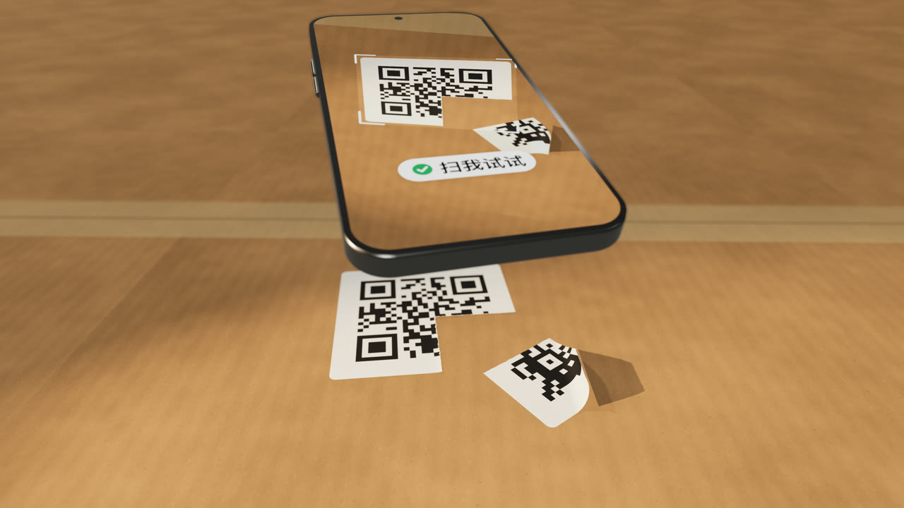
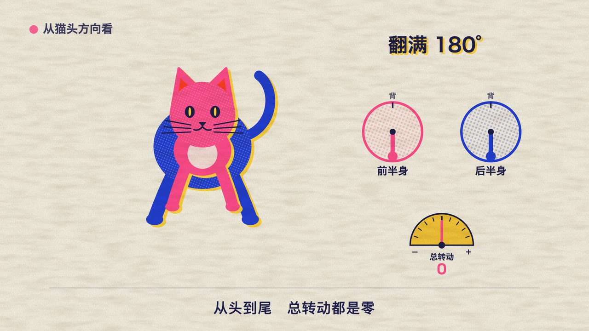

# topic-to-video

<p align="center">
  <a href="README_CN.md"><strong>简体中文</strong></a> ·
  <a href="https://video.addsum.top"><strong>Watch the films</strong></a> ·
  <a href="#quick-start"><strong>Quick start</strong></a>
</p>

<p align="center">
  <a href="https://github.com/addsumtech/topic-to-video/releases"></a>
  <a href="LICENSE"></a>
  
  
  
  
</p>

> **One sentence in, a finished film out.** Ask for a video about a topic, a product or your slides. It researches, writes the script and lets you hear it, designs the film, builds it shot by shot, scores and captions it, and checks every frame before you see it.

A skill for Claude Code and Codex. It works the way a small studio does, not like a model painting frames: **every frame is built in code and rendered**, with real type, real diagrams, real 3D and real data. Facts stay exact, labels land where they belong, and every frame can be checked.

## Made with it

Every film below began as one request in a chat. Click one to watch it on **[video.addsum.top](https://video.addsum.top)**.

<table>
  <tr>
    <td width="33%"><a href="https://video.addsum.top/#topic-to-video-promo"></a><br/><sub><strong>topic-to-video launch film</strong> · English · 2:00<br/>Its own launch film, cut from real clips of these films</sub></td>
    <td width="33%"><a href="https://video.addsum.top/#mri-explainer"></a><br/><sub><strong>How an MRI scanner makes a picture</strong> · English · 2:07<br/>A real brain slice rebuilt from its own chord; the scanner in Blender</sub></td>
    <td width="33%"><a href="https://video.addsum.top/#diamond-sparkle-3d"></a><br/><sub><strong>Why a diamond sparkles</strong> · Chinese · 1:44<br/>Every stone rendered in Blender; the fire is real dispersion</sub></td>
  </tr>
  <tr>
    <td width="33%"><a href="https://video.addsum.top/#grok-bot-explainer"></a><br/><sub><strong>Grok Bot launch film</strong> · English · 2:02<br/>Phone and app screens built from the official screenshots</sub></td>
    <td width="33%"><a href="https://video.addsum.top/#qr-torn-corner"></a><br/><sub><strong>Why a torn QR code still scans</strong> · Chinese · 1:45<br/>One real code; every tear checked with a real decoder</sub></td>
    <td width="33%"><a href="https://video.addsum.top/#job-hunt-promo"></a><br/><sub><strong>job-hunt launch film</strong> · Chinese · 2:14<br/>Claude Code and Codex windows recorded from the real programs</sub></td>
  </tr>
  <tr>
    <td width="33%"><a href="https://video.addsum.top/#falling-cat"></a><br/><sub><strong>Why a falling cat lands on its feet</strong> · Chinese · 2:03<br/>The two-cylinder model, drawn as a risograph print</sub></td>
    <td width="33%"><a href="https://video.addsum.top/#camera-lens"></a><br/><sub><strong>How a lens makes a sharp image</strong> · English · 2:01<br/>From one point of light to a cone of rays meeting again</sub></td>
    <td width="33%"><a href="https://video.addsum.top/#workbuddy-promo"></a><br/><sub><strong>WorkBuddy launch film</strong> · English · 1:02<br/>The wordmark's underscore becomes the film's cursor</sub></td>
  </tr>
</table>

## How it works

```text
 research ─▶ script ─▶ voice ─▶ design ─▶ animatic ─▶ build ─▶ sound ─▶ check ─▶ MP4 + SRT
             └── you hear it ──┘   └── you approve ──┘
```

1. **Research.** It reads your material or the web, and pins every date and figure to a quote from a source it fetched.
2. **Script and voice.** It writes for the ear, then lets you *hear* the script and pick the voice before anything is built.
3. **Design.** A dedicated designer works out three concepts, the film's signature idea and three finished hero keyframes. You choose.
4. **Animatic.** The whole film, rough, on the real voice's clock, so you can judge the rhythm while changes are cheap.
5. **Build.** One look, sequence by sequence, with light, material and real 3D where the subject needs it. Builders work in parallel and check their own shots as they go.
6. **Sound and check.** Sound effects on real events; a score only for launch films, held under the voice. Then up to 15 automatic checks on the rendered film, and a look at every shot.

You make four calls: what to make, the voice, the design and the animatic. The rest runs on its own.

## Why it's different

- 🔎 **Sourced, not invented.** Every number on screen or in the voice traces to a source. If a figure can't be sourced, the film says it in words instead.
- 💡 **A signature idea per film.** Something only this subject could have: the diamond's fire rendered from its real dispersion, a brain slice that sings its own chord, a QR code decoded on the film's own frames.
- 🧊 **Real objects, real screens.** Blender renders for glass, metal and machines; lit phones, tablets and laptops; app screens rebuilt from official screenshots; terminal windows recorded cell by cell from the real Claude Code, Codex and shell.
- 🧪 **Checked on the rendered frames.** Flashes, replays after a cut, camera moves that step instead of glide, banding in dark gradients, overlapping or cut-off text, objects passing through each other, a hidden seam that is really a bare cut, any word on screen it can't source.
- 🎵 **Music follows purpose.** Explainers have none, because music under narration costs the viewer recall. Launch films are scored, measured to sit about 20 dB under the voice.
- 🗣️ **Any language, free voice.** edge-tts by default, word-synced captions, Chinese included. It can voice an English deck in Chinese, or the reverse.
- ✏️ **You keep the taste.** Ask for a change in plain words; only the shots it touches are rebuilt.

## Two paths

| | **Director path** (default) | **Classic mode** |
| --- | --- | --- |
| What it makes | A film designed as a whole: one look, a signature idea, built sequence by sequence | Your deck voiced as it is, a designed HTML page per beat, or a film assembled from 227 hand-built shot designs (Remotion) |
| Best for | Explainers, launch and product films, anything that should feel made | Narrating existing slides, teaching pages, a fast library-built cut |
| Needs | Chrome; Blender for real 3D | ffmpeg only (deck as-is); Chrome (pages); Node.js (Remotion) |

Ask for a topic or a product and you get the director path. Say "voice my deck as it is" or name the shot library and you get classic mode.

## Quick start

**1. Install the tools:** Python 3.9+, ffmpeg and Google Chrome. Add Blender (optional) for real 3D shots, LibreOffice for .pptx input, and Node.js for classic mode's Remotion renderer.

```bash
# macOS (Linux: apt install ffmpeg libreoffice)
brew install ffmpeg && brew install --cask libreoffice
```

**2. Install the skill:**

```bash
# Claude Code
git clone --depth 1 https://github.com/addsumtech/topic-to-video.git ~/.claude/skills/topic-to-video
# Codex
git clone --depth 1 https://github.com/addsumtech/topic-to-video.git ~/.agents/skills/topic-to-video

python3 -m pip install pillow pymupdf python-pptx edge-tts pyte faster-whisper
cd ~/.claude/skills/topic-to-video/remotion && npm install   # classic mode's Remotion renderer, once
```

<details>
<summary>Other ways to install: Claude Code plugin, npx skills</summary>

- **Claude Code plugin:** `/plugin marketplace add addsumtech/topic-to-video`, then `/plugin install topic-to-video@topic-to-video`. Remove any copy in `~/.claude/skills/` first, or the skill shows up twice. Update with `/plugin marketplace update topic-to-video`.
- **npx skills:** `npx skills add addsumtech/topic-to-video`.

However you install it, the tools in step 1 still apply, and for the Remotion renderer run `npm install` once inside the skill's `remotion/` folder.
</details>

**3. Ask for a video.** You don't have to say "skill":

```text
Make a 2-minute video explaining how an espresso machine pulls a shot.
Make a launch film for our app from the screenshots in ./press-kit.
做一个讲解视频：深圳是怎么从边境小镇变成超大城市的，竖屏，中文配音。
Turn slides/q3-review.pptx into a narrated video with a Chinese voice-over.
```

It asks a few questions, lets you hear the script, shows you the design and an animatic, then copies the MP4 and SRT to your Desktop.

## Good to know

- **Local files, not a cloud service.** You get an MP4 plus an SRT. No accounts, no share links.
- **Quality takes agent time.** A designed film takes a few hours of agent time, mostly design, building and checking. Rendering itself takes minutes.
- **Something missing?** `python3 scripts/doctor.py` lists each tool and the exact command to install it.
- **No voice?** edge-tts needs a network connection. Offline on macOS, it falls back to the system `say` voice.
- **Pairs with [slide-maker](https://github.com/addsumtech/slides_maker):** make the deck there, narrate it here.

## License

[MIT](LICENSE)
