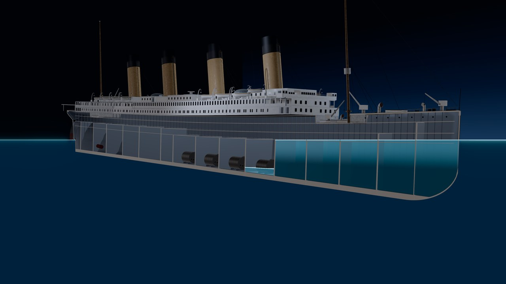
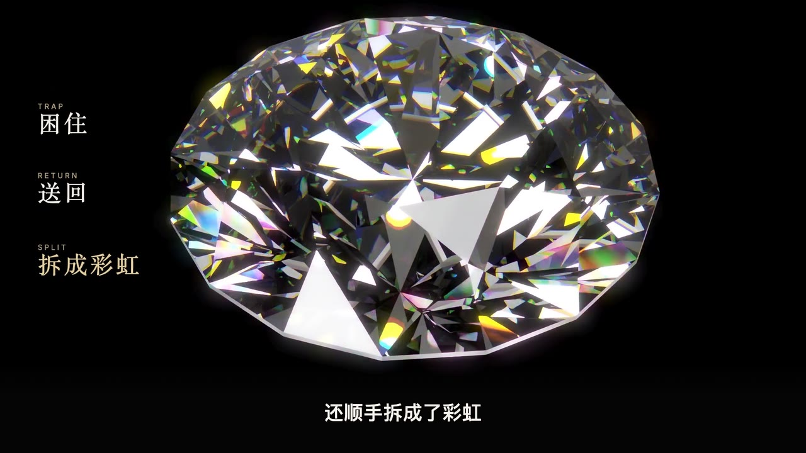
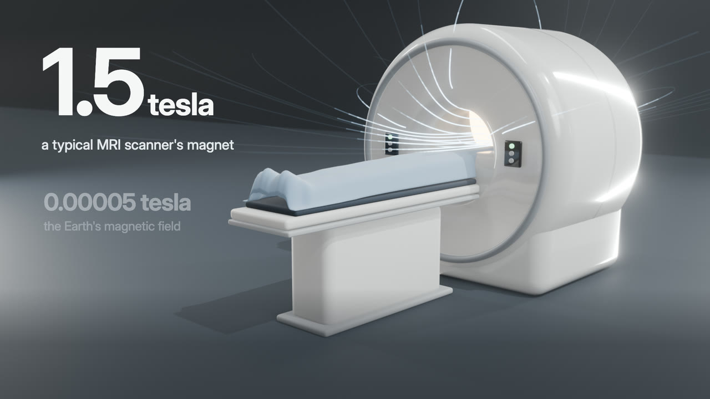
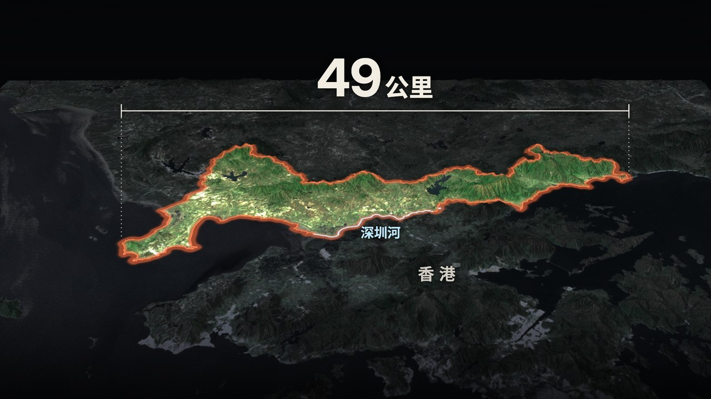
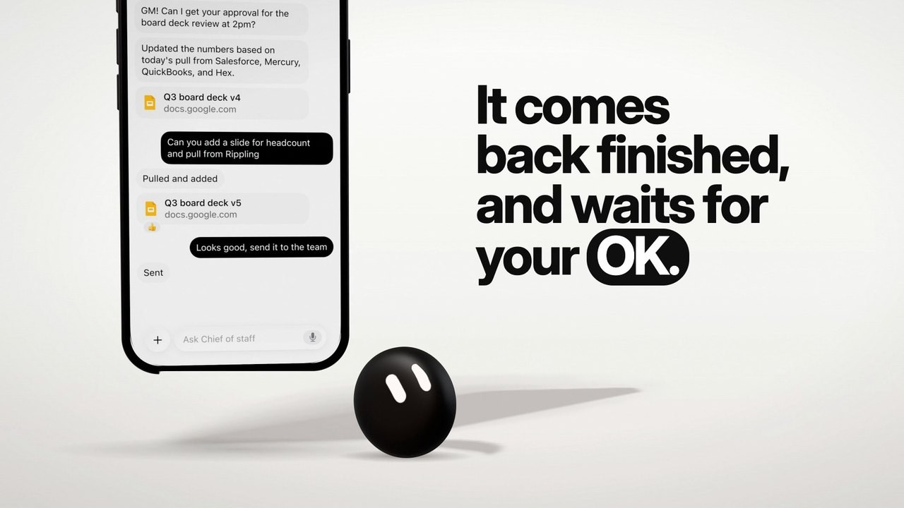
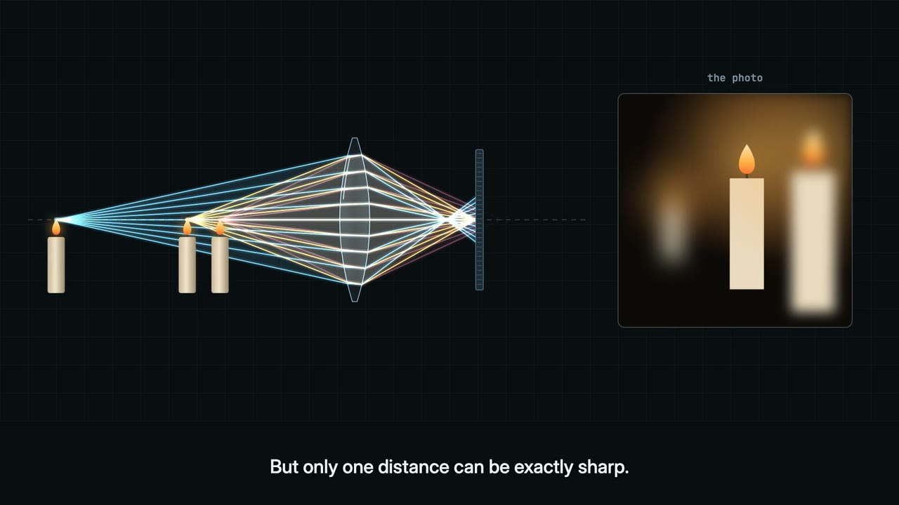
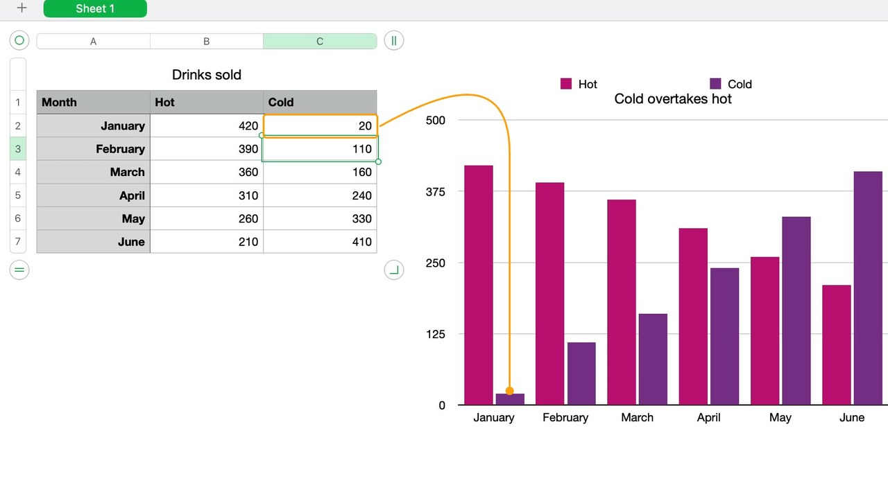
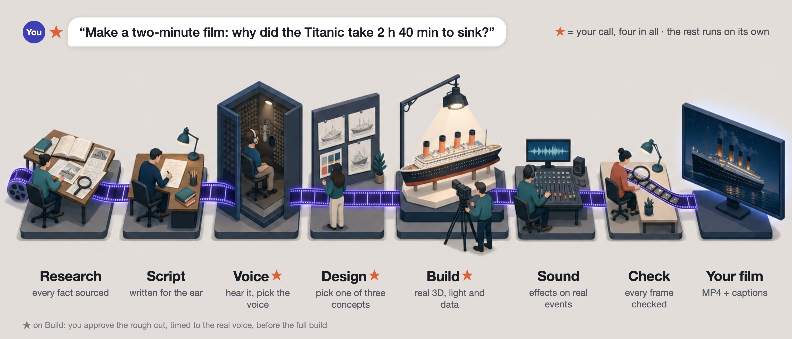

# topic-to-video

<p align="center">
  <a href="README_CN.md"><strong>简体中文</strong></a> ·
  <a href="https://video.addsum.top"><strong>Watch the films</strong></a> ·
  <a href="#quick-start"><strong>Quick start</strong></a>
</p>

<p align="center">
  <a href="https://github.com/addsumtech/topic-to-video/releases"></a>
  <a href="LICENSE"></a>
  
  
  
  
</p>

> **You direct. It is the whole film crew.** Say one sentence; get back a researched, narrated, designed and checked film, made on your own machine and free by default.

A skill for Claude Code and Codex that turns your agent into a small film studio: researcher, scriptwriter, voice, designer, 3D artist, sound and quality control. Nothing is painted by a video model: **every frame is built in code and rendered**, with real type, real 3D, real data and real app screens. So the facts are exact, the physics is computed, and every frame can be checked.

## Made with it

Each of these began as one sentence in a chat. Click one to watch it, or see all seventeen on **[video.addsum.top](https://video.addsum.top)**.

<table>
  <tr>
    <td width="33%"><a href="https://video.addsum.top/#titanic-sinking"></a><br/><sub><strong>Why the Titanic took 2 h 40 min to sink</strong> · English · 1:49<br/>The ship in Blender from the 1911 plans; the flooding as the 1912 inquiry found it</sub></td>
    <td width="33%"><a href="https://video.addsum.top/#diamond-sparkle-3d"></a><br/><sub><strong>Why a diamond sparkles</strong> · Chinese · 1:44<br/>Every stone rendered in Blender; the fire is real dispersion</sub></td>
    <td width="33%"><a href="https://video.addsum.top/#mri-explainer"></a><br/><sub><strong>How an MRI scanner makes a picture</strong> · English · 2:07<br/>A real brain slice rebuilt from its own chord; the scanner in Blender</sub></td>
  </tr>
  <tr>
    <td width="33%"><a href="https://video.addsum.top/#shenzhen-border-town"></a><br/><sub><strong>How Shenzhen became a megacity</strong> · Chinese · 2:10<br/>Told with real Landsat satellite images, 1979 to 2025</sub></td>
    <td width="33%"><a href="https://video.addsum.top/#falling-cat"></a><br/><sub><strong>Why a falling cat lands on its feet</strong> · Chinese · 2:03<br/>The two-cylinder model, drawn as a risograph print</sub></td>
    <td width="33%"><a href="https://video.addsum.top/#qr-torn-corner"></a><br/><sub><strong>Why a torn QR code still scans</strong> · Chinese · 1:45<br/>One real code; every tear checked with a real decoder</sub></td>
  </tr>
  <tr>
    <td width="33%"><a href="https://video.addsum.top/#grok-bot-promo-38s"></a><br/><sub><strong>Grok Bot in 38 seconds</strong> · English · 0:38<br/>Type and music, set in the app’s official screenshots</sub></td>
    <td width="33%"><a href="https://video.addsum.top/#camera-lens"></a><br/><sub><strong>How a lens makes a sharp image</strong> · English · 2:01<br/>From one point of light to a cone of rays meeting again</sub></td>
    <td width="33%"><a href="https://video.addsum.top/#numbers-chart-tutorial"></a><br/><sub><strong>Make a chart in Numbers</strong> · English · 1:16<br/>A software tutorial: every click recorded from the real app</sub></td>
  </tr>
</table>

## How it works

<p align="center"></p>

You make four calls: what to make, the voice (after hearing the script), the design, and the rough cut. Everything else runs on its own, and the finished MP4 and captions land on your Desktop.

## Why it's different

| | Video-generating AI models | **topic-to-video** |
| --- | --- | --- |
| **On screen** | Pixels guessed by a model; text and numbers often come out garbled | Built in code and rendered: exact type, real 3D, real data, real app screens |
| **Facts** | Whatever sounds right | Every figure traced to a quoted source; an unsourced one is said in words instead |
| **Physics** | Looks plausible | Computed: the diamond's fire from its real dispersion, the Titanic's flooding from the 1912 inquiry |
| **Length** | Short clips | A 1–3 minute narrated film with word-synced captions, in any language |
| **One change** | Re-roll and hope | Say it in plain words; only the shots it touches are rebuilt |
| **Cost** | Credits per clip | Free by default: local rendering and a free voice |

And every film gets a **signature idea** only its subject could have: a brain slice that sings its own chord, a QR code decoded on the film's own frames, a sea that spills over each wall of the Titanic in turn.

## What's inside

| Role | What it does |
| --- | --- |
| **Researcher** | Reads your material or the web and pins every date and figure to a quote from a source it fetched |
| **Writer and voice** | Writes for the ear, lets you hear it, then voices it (edge-tts free; MiniMax or OpenAI optional) with word-level timing, and transcribes it back to catch a dropped or misread line |
| **Designer** | Three concepts, a signature idea and finished hero keyframes; then the whole film as a rough cut on the real voice |
| **Builders** | Blender and a lit 3D stage for objects, typed motion for text, real photos, maps and satellite images, apps and terminals recorded from the real programs |
| **Sound** | Effects on real events; a score only for launch films, held under the voice |
| **Checker** | Up to 15 automatic checks on the rendered film (flashes, steps in a camera move, banding, clipped or overlapping text, objects passing through each other), then every shot opened at full size |

## Two paths

| | **Director path** (default) | **Classic mode** |
| --- | --- | --- |
| What it makes | A film designed as a whole: one look, a signature idea, built sequence by sequence | Your deck voiced as it is, a designed HTML page per beat, or a film assembled from 227 hand-built shot designs (Remotion) |
| Best for | Explainers, launch and product films, anything that should feel made | Narrating existing slides, teaching pages, a fast library-built cut |
| Needs | Chrome; Blender for real 3D | ffmpeg only (deck as-is); Chrome (pages); Node.js (Remotion) |

Ask for a topic or a product and you get the director path. Say "voice my deck as it is" or name the shot library and you get classic mode.

## Quick start

**1. Install the tools:** Python 3.9+, ffmpeg and Google Chrome. Add Blender (optional) for real 3D shots, LibreOffice for .pptx input, and Node.js for classic mode's Remotion renderer.

```bash
# macOS (Linux: apt install ffmpeg libreoffice)
brew install ffmpeg && brew install --cask libreoffice
```

**2. Install the skill:**

```bash
# Claude Code
git clone --depth 1 https://github.com/addsumtech/topic-to-video.git ~/.claude/skills/topic-to-video
# Codex
git clone --depth 1 https://github.com/addsumtech/topic-to-video.git ~/.agents/skills/topic-to-video

python3 -m pip install pillow pymupdf python-pptx edge-tts pyte faster-whisper pypinyin
cd ~/.claude/skills/topic-to-video/remotion && npm install   # classic mode's Remotion renderer, once
```

<details>
<summary>Other ways to install: Claude Code plugin, npx skills</summary>

- **Claude Code plugin:** `/plugin marketplace add addsumtech/topic-to-video`, then `/plugin install topic-to-video@topic-to-video`. Remove any copy in `~/.claude/skills/` first, or the skill shows up twice. Update with `/plugin marketplace update topic-to-video`.
- **npx skills:** `npx skills add addsumtech/topic-to-video`.

However you install it, the tools in step 1 still apply, and for the Remotion renderer run `npm install` once inside the skill's `remotion/` folder.
</details>

**3. Ask for a video.** You don't have to say "skill":

```text
Make a 2-minute video explaining how an espresso machine pulls a shot.
Make a launch film for our app from the screenshots in ./press-kit.
做一个讲解视频：深圳是怎么从边境小镇变成超大城市的，竖屏，中文配音。
Turn slides/q3-review.pptx into a narrated video with a Chinese voice-over.
```

It asks a few questions, lets you hear the script, shows you the design and an animatic, then copies the MP4 and SRT to your Desktop.

## Good to know

- **Local files, not a cloud service.** You get an MP4 plus an SRT. No accounts, no share links.
- **Quality takes agent time.** A designed film takes a few hours of agent time, mostly design, building and checking. Rendering itself takes minutes.
- **Something missing?** `python3 scripts/doctor.py` lists each tool and the exact command to install it.
- **No voice?** edge-tts needs a network connection. Offline on macOS, it falls back to the system `say` voice.
- **Pairs with [slide-maker](https://github.com/addsumtech/slides_maker):** make the deck there, narrate it here.

## License

[MIT](LICENSE). Some motion timings in `assets/html/moments.js` are adapted from
[video-shotcraft](https://github.com/Vincentwei1021/video-shotcraft) (Apache-2.0); see [NOTICE](NOTICE).
