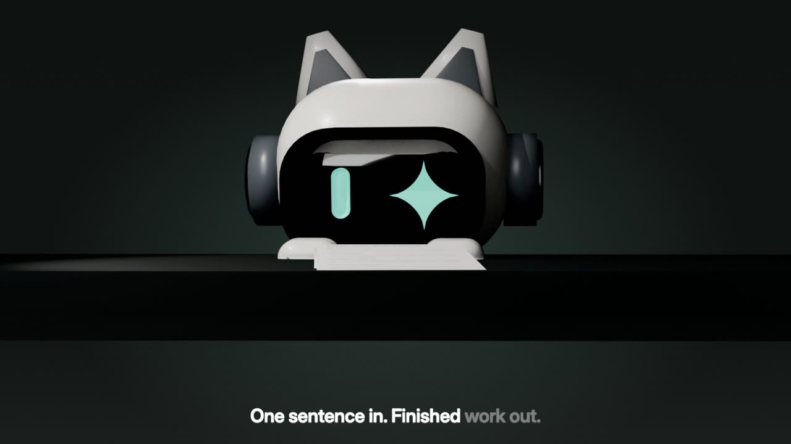
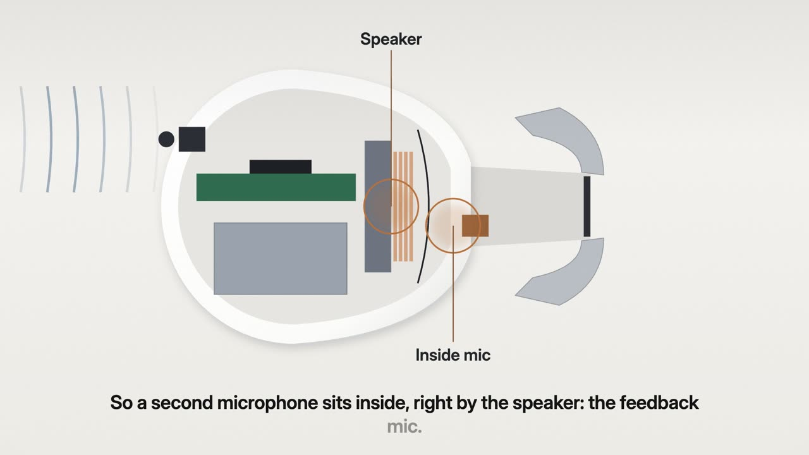
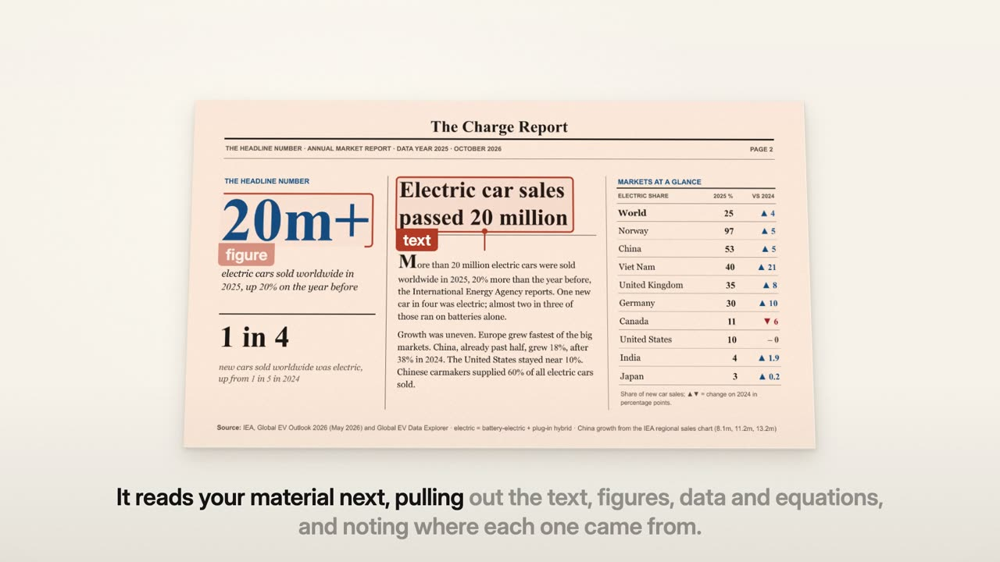
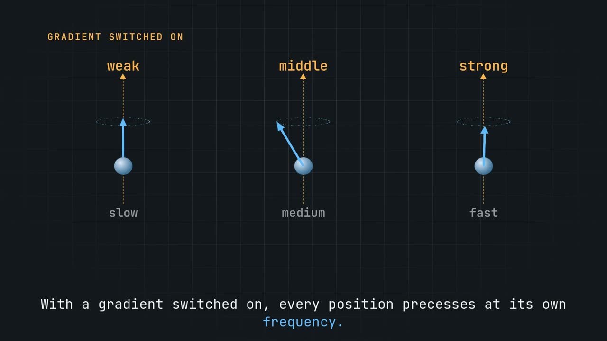

# topic-to-video

<p align="center">
  <a href="README_CN.md"><strong>简体中文</strong></a> ·
  <a href="https://video.addsum.top"><strong>Watch the films</strong></a>
</p>

<p align="center">
  <a href="LICENSE"></a>
  
  
  
  
</p>

> **One sentence in, a finished explainer out.** Ask for a video about a topic, or hand it your slides. It researches, writes and voices the script, designs every shot, renders the film with captions and checks it before you see it.

A skill for Claude Code and Codex. It is not a model painting frames: **every frame is drawn as code**, with real type, real diagrams and real data. That means facts stay exact, labels land in the right place, and every frame can be checked.

## Made with it

Every film below began as a single request in a chat. Click one to watch it on **[video.addsum.top](https://video.addsum.top)**.

<table>
  <tr>
    <td width="33%"><a href="https://video.addsum.top/#workbuddy-promo"></a><br/><sub><strong>Product film</strong> · English · 2:16<br/>App UI rebuilt from screenshots, six shots rendered in Blender</sub></td>
    <td width="33%"><a href="https://video.addsum.top/#anc-headphones"></a><br/><sub><strong>How noise cancelling works</strong> · English · 2:43<br/>The flipped wave, the two mics, the tiny time window</sub></td>
    <td width="33%"><a href="https://video.addsum.top/#slide-maker-promo"></a><br/><sub><strong>Launch film</strong> · English · 2:48<br/>Cut to music; every deck page on screen is real output</sub></td>
  </tr>
  <tr>
    <td width="33%"><a href="https://video.addsum.top/#qr-code-explainer"></a><br/><sub><strong>How a QR code is read</strong> · Chinese · 2:49<br/>Every code on screen is real and decoder-checked</sub></td>
    <td width="33%"><a href="https://video.addsum.top/#mri-explainer"></a><br/><sub><strong>How MRI makes an image</strong> · English · 2:17<br/>The k-space on screen is a computed Fourier transform</sub></td>
    <td width="33%"><a href="https://video.addsum.top/#job-hunt-promo"></a><br/><sub><strong>Product film</strong> · Chinese · 2:32<br/>Roles, fit, CV and interview practice in one story</sub></td>
  </tr>
</table>

## Why it's different

- 🔎 **Sourced, not invented.** Every date and figure in the narration is pinned to a quote from a page it fetched. If a number can't be sourced, the film says it qualitatively.
- 🎬 **Designed shot by shot.** It picks from 225 hand-built shot designs (cutaways, compare panels, routes, timelines, phone demos, data stages) and builds what the library lacks. Heavier 3D shots render in Blender.
- 👁️ **The picture says the thing.** Each shot is built for what its line claims. Hide the caption and the picture should still carry the idea.
- 🗣️ **Any language, free voice.** edge-tts by default, word-synced captions, Chinese included. It can voice an English deck in Chinese, or the reverse.
- 🧪 **Checked on the rendered frames.** Text out of frame, captions over content, audio sync, text jitter during camera moves, leftover placeholders.
- 📐 **Any canvas.** 16:9, 9:16, 1:1, 4:5, 4:3. Shots recompose for the frame instead of being cropped.
- ✏️ **You keep the taste.** You see an early render, say what to change, and only the changed shots re-render.

## Two renderers

| | **Cinematic** (Remotion) | **Page** (HTML) |
| --- | --- | --- |
| A shot is | An animated shot from 225 designs, plus objects built for the film | A designed page per beat: flows, tables, charts, code, equations |
| Motion | Camera moves, depth, cuts planned across the film | Each point appears on the word that names it |
| Best for | Launches, promos, stories, how a mechanism works | Teaching, how-tos, research briefings, narrating a deck |
| Needs | Node.js | Chrome only |

Just want your own slides narrated as they are? A third mode shows each slide full-frame with gentle motion and needs only ffmpeg.

## Quick start

**1. Install the tools:** Python 3.9+, ffmpeg and Google Chrome. Add Node.js for the cinematic renderer, LibreOffice for .pptx input, and Blender (optional) for 3D shots.

```bash
# macOS (Linux: apt install ffmpeg libreoffice)
brew install ffmpeg && brew install --cask libreoffice
```

**2. Install the skill:**

```bash
# Claude Code
git clone --depth 1 https://github.com/addsumtech/topic-to-video.git ~/.claude/skills/topic-to-video
# Codex
git clone --depth 1 https://github.com/addsumtech/topic-to-video.git ~/.agents/skills/topic-to-video

python3 -m pip install pillow pymupdf python-pptx edge-tts
cd ~/.claude/skills/topic-to-video/remotion && npm install   # cinematic renderer, once
```

<details>
<summary>Other ways to install: Claude Code plugin, npx skills</summary>

- **Claude Code plugin:** `/plugin marketplace add addsumtech/topic-to-video`, then `/plugin install topic-to-video@topic-to-video`. Remove any copy in `~/.claude/skills/` first, or the skill shows up twice. Update with `/plugin marketplace update topic-to-video`.
- **npx skills:** `npx skills add addsumtech/topic-to-video`.

However you install it, the tools in step 1 still apply, and for the cinematic renderer run `npm install` once inside the skill's `remotion/` folder.
</details>

**3. Ask for a video.** You don't have to say "skill":

```text
Make a 90-second video explaining how an espresso machine pulls a shot.
做一个讲解视频：深圳是怎么从边境小镇变成超大城市的，竖屏，中文配音。
Turn slides/q3-review.pptx into a narrated video with a Chinese voice-over.
```

It asks a few questions, shows you the plan and an early render, then copies the MP4 and SRT to your Desktop.

## Good to know

- **Local files, not a cloud service.** You get an MP4 plus an SRT. No accounts, no share links.
- **Quality takes agent time.** Our test films took one to two hours each, mostly planning, building and checking. The render itself takes minutes.
- **Something missing?** `python3 scripts/doctor.py` lists each tool and the exact command to install it.
- **No voice?** edge-tts needs a network connection. Offline on macOS, it falls back to the system `say` voice.
- **Pairs with [slide-maker](https://github.com/addsumtech/slides_maker):** make the deck there, narrate it here.

## License

[MIT](LICENSE)
