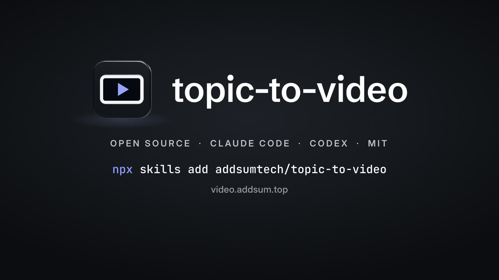
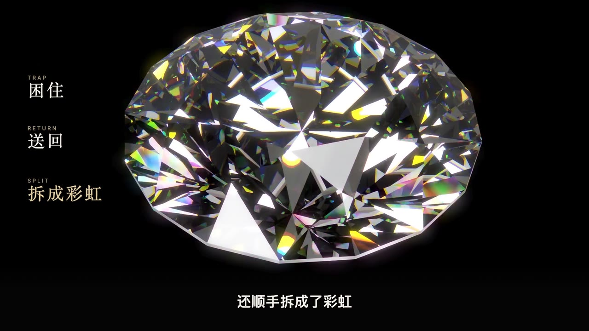
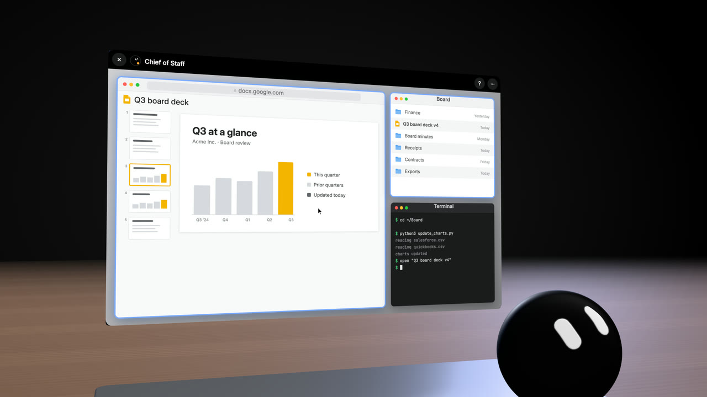
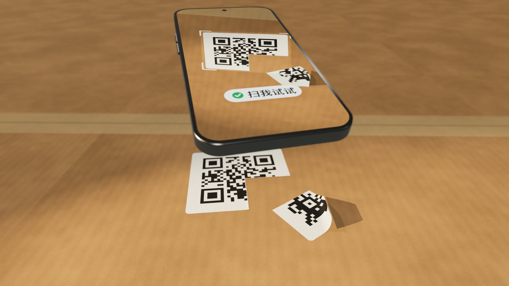
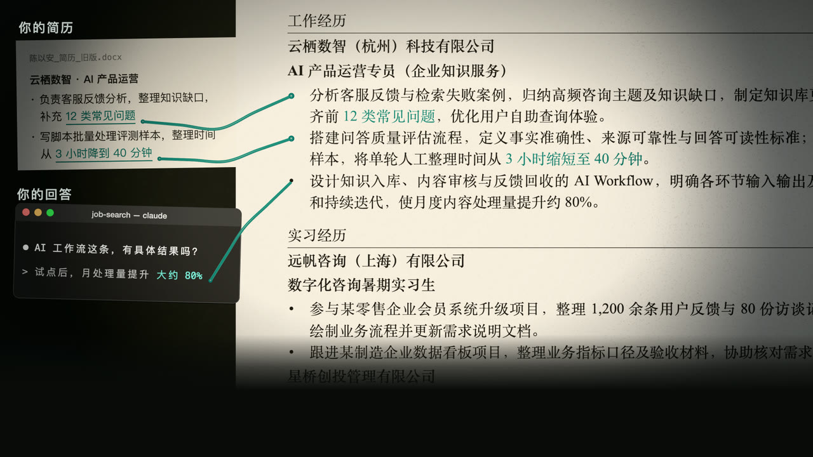
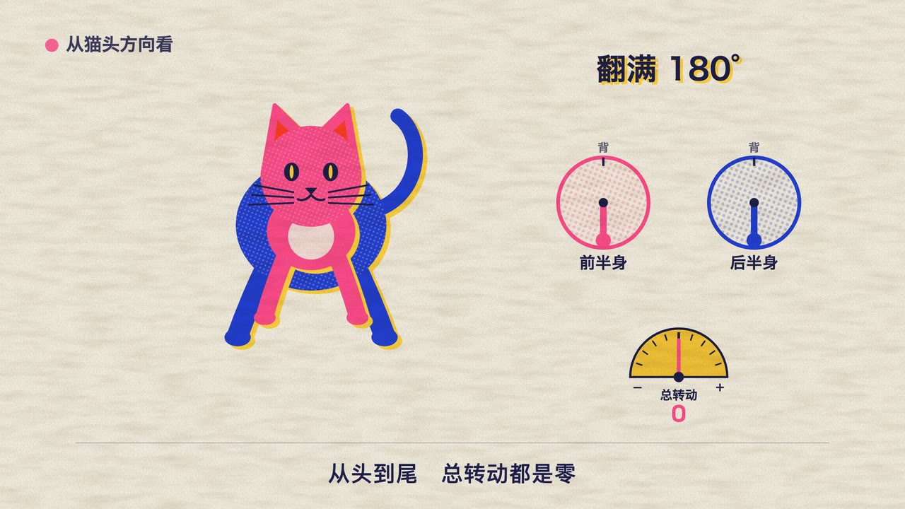
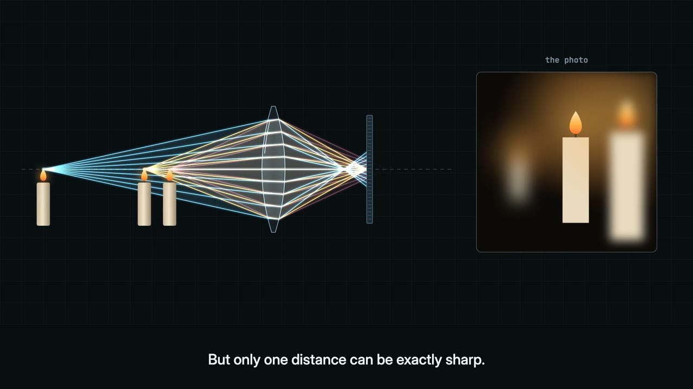
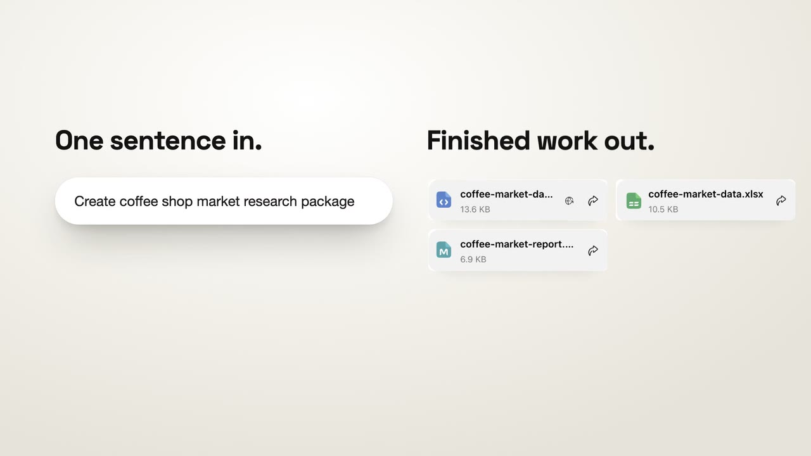
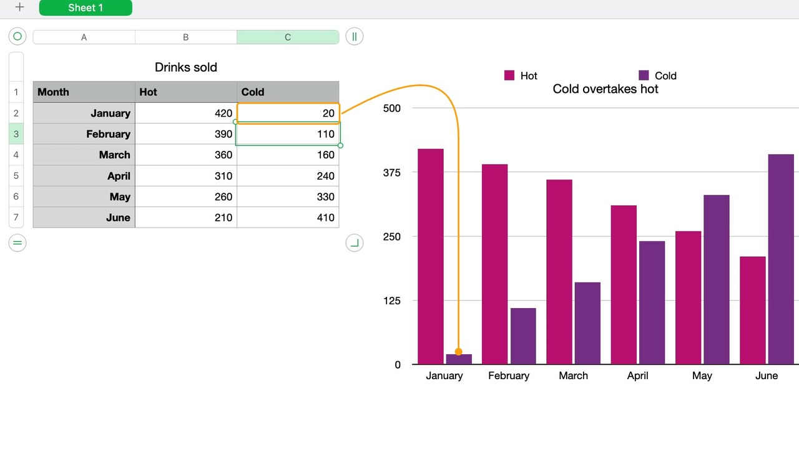

# topic-to-video

<p align="center">
  <a href="README.md"><strong>English</strong></a> ·
  <a href="https://video.addsum.top/cn/"><strong>看成片</strong></a> ·
  <a href="#快速开始"><strong>快速开始</strong></a>
</p>

<p align="center">
  <a href="https://github.com/addsumtech/topic-to-video/releases"></a>
  <a href="LICENSE"></a>
  
  
  
  
</p>

> **一句话进去，一部成片出来。** 说一个主题、一个产品，或者丢给它一份幻灯片：它查资料、写讲稿并先让你试听、设计整部片、逐个镜头制作、配乐配字幕，并在交给你之前把每一帧都检查一遍。

这是一个 Claude Code / Codex 技能。它像一个小型工作室那样做片，而不是让大模型去"画"每一帧：**每一帧都用代码搭建、再渲染出来**，文字、图表、3D 和数据都是真的。所以事实准确、标注不会错位，每一帧都能被检查。

## 用它做的片子

下面每一部都起于聊天里的一句话请求。点击可在 **[video.addsum.top](https://video.addsum.top/cn/)** 观看。

<table>
  <tr>
    <td width="33%"><a href="https://video.addsum.top/cn/#topic-to-video-promo"></a><br/><sub><strong>topic-to-video 发布短片</strong> · 英文 · 2:00<br/>它自己的发布片，用这些成片的真实片段剪成</sub></td>
    <td width="33%"><a href="https://video.addsum.top/cn/#mri-explainer"></a><br/><sub><strong>MRI 是怎么拍出身体内部的</strong> · 英文 · 2:07<br/>一张真实脑切片由它自己的和弦重建；扫描仪用 Blender 渲染</sub></td>
    <td width="33%"><a href="https://video.addsum.top/cn/#diamond-sparkle-3d"></a><br/><sub><strong>钻石为什么会闪闪发光</strong> · 中文 · 1:44<br/>每颗钻石都用 Blender 渲染，火彩是真实的色散</sub></td>
  </tr>
  <tr>
    <td width="33%"><a href="https://video.addsum.top/cn/#grok-bot-explainer"></a><br/><sub><strong>Grok Bot 发布短片</strong> · 英文 · 2:02<br/>手机和应用界面按官方截图还原</sub></td>
    <td width="33%"><a href="https://video.addsum.top/cn/#qr-torn-corner"></a><br/><sub><strong>二维码撕掉一角为什么还能扫</strong> · 中文 · 1:45<br/>一张真实的二维码，每一种撕法都用真实解码器验证</sub></td>
    <td width="33%"><a href="https://video.addsum.top/cn/#job-hunt-promo"></a><br/><sub><strong>job-hunt 发布短片</strong> · 中文 · 2:14<br/>Claude Code 和 Codex 窗口录自真实程序</sub></td>
  </tr>
  <tr>
    <td width="33%"><a href="https://video.addsum.top/cn/#falling-cat"></a><br/><sub><strong>猫为什么总能四脚着地</strong> · 中文 · 2:03<br/>两节圆柱模型，画成孔版印刷的样子</sub></td>
    <td width="33%"><a href="https://video.addsum.top/cn/#camera-lens"></a><br/><sub><strong>镜头怎样拍出清晰的照片</strong> · 英文 · 2:01<br/>从一个光点讲到一锥光线重新会聚</sub></td>
    <td width="33%"><a href="https://video.addsum.top/cn/#workbuddy-promo"></a><br/><sub><strong>WorkBuddy 发布短片</strong> · 英文 · 1:02<br/>字标末尾的下划线变成全片的光标</sub></td>
  </tr>
  <tr>
    <td width="33%"><a href="https://video.addsum.top/cn/#numbers-chart-tutorial"></a><br/><sub><strong>在 Numbers 里做一张图表</strong> · 英文 · 1:04<br/>软件操作教程：每一次点击都录自真实软件</sub></td>
  </tr>
</table>

## 它怎么做片

```text
 调研 ─▶ 讲稿 ─▶ 配音 ─▶ 设计 ─▶ 动态分镜 ─▶ 制作 ─▶ 声音 ─▶ 检查 ─▶ MP4 + SRT
        └── 你来试听 ──┘   └──── 你来拍板 ────┘
```

1. **调研。** 读你给的材料或上网查，解说里的每个日期和数字都对应它抓到的原文。
2. **讲稿和配音。** 写成适合耳朵听的稿子，开工之前先让你*听到*讲稿、挑好声音。
3. **设计。** 由专门的设计师出三个方向、整部片的招牌创意，以及三张完成度很高的关键帧，由你来选。
4. **动态分镜。** 整部片的粗版，按真实配音的时间走一遍，趁改动还便宜时判断节奏。
5. **制作。** 一种视觉风格贯穿全片，一段一段地做；题材需要时加上光影、材质和真正的 3D。多个制作者并行，各自边做边检查自己的镜头。
6. **声音和检查。** 音效只配在真实发生的动作上；只有发布片才配乐，并压在人声之下。最后对渲染出来的成片跑最多 15 项自动检查，再逐个镜头看一遍。

你只需要拍板四次：做什么、用哪个声音、选哪个设计、动态分镜行不行。其余的它自己跑完。

## 有什么不同

- 🔎 **有出处，不编造。** 画面和解说里的每个数字都能追溯到出处。找不到出处的数字，片子里只做定性描述。
- 💡 **每部片都有招牌创意。** 只有这个题材才有的那一下：按真实色散渲染的钻石火彩、会唱出自己和弦的脑切片、在片子自己的画面上被解码的二维码。
- 🧊 **真物件，真界面。** 玻璃、金属、机器用 Blender 渲染；有打光的手机、平板和笔记本；应用界面按官方截图还原；终端窗口逐格录自真实的 Claude Code、Codex 和 shell。
- 🧪 **检查的是渲染出来的画面。** 闪帧、切镜后画面倒回、运镜一顿一顿而不顺滑、暗部渐变出现色带、文字重叠或被截断、物体互相穿模、说好藏住的转场其实是硬切、屏幕上任何找不到出处的文字，都会被查出来。
- 🎵 **配乐看用途。** 讲解片不配乐，因为解说下面垫音乐会让观众记得更少；发布片配乐，并实测压在人声之下约 20 dB。
- 🗣️ **任何语言，免费配音。** 默认用 edge-tts，字幕逐词同步，中文同样支持。英文幻灯片可以配中文解说，反过来也行。
- ✏️ **审美由你把关。** 用大白话说要改哪里，只重做受影响的镜头。

## 两条路径

| | **导演式**（默认） | **经典模式** |
| --- | --- | --- |
| 做出来的是 | 作为整体设计的一部片：一种风格、一个招牌创意，一段一段地搭出来 | 幻灯片原样配解说、每段一张设计好的 HTML 页面，或用 227 种手工打磨的镜头设计拼出的影片（Remotion） |
| 最适合 | 讲解片、发布片和产品片，任何需要"做出来"质感的片子 | 给现成幻灯片配解说、教学页面、用镜头库快速出片 |
| 需要 | Chrome；真 3D 需要 Blender | 只要 ffmpeg（幻灯片原样）；Chrome（页面）；Node.js（Remotion） |

说一个主题或产品，走的就是导演式；说"把我的幻灯片原样配音"或点名要镜头库，走的就是经典模式。

## 快速开始

**1. 装好工具：** Python 3.9+、ffmpeg、Google Chrome。真 3D 镜头可选装 Blender，输入 .pptx 需要 LibreOffice，经典模式的 Remotion 渲染需要 Node.js。

```bash
# macOS（Linux：apt install ffmpeg libreoffice）
brew install ffmpeg && brew install --cask libreoffice
```

**2. 安装技能：**

```bash
# Claude Code
git clone --depth 1 https://github.com/addsumtech/topic-to-video.git ~/.claude/skills/topic-to-video
# Codex
git clone --depth 1 https://github.com/addsumtech/topic-to-video.git ~/.agents/skills/topic-to-video

python3 -m pip install pillow pymupdf python-pptx edge-tts pyte faster-whisper pypinyin
cd ~/.claude/skills/topic-to-video/remotion && npm install   # 经典模式的 Remotion 渲染，只需一次
```

<details>
<summary>其他安装方式：Claude Code 插件、npx skills</summary>

- **Claude Code 插件：** `/plugin marketplace add addsumtech/topic-to-video`，然后 `/plugin install topic-to-video@topic-to-video`。先删掉 `~/.claude/skills/` 里已有的副本，否则会出现两个同名技能。更新用 `/plugin marketplace update topic-to-video`。
- **npx skills：** `npx skills add addsumtech/topic-to-video`。

不管用哪种方式安装，第 1 步的工具都需要；要用 Remotion 渲染，在技能的 `remotion/` 文件夹里运行一次 `npm install`。
</details>

**3. 直接说你要什么视频**，不用提"技能"两个字：

```text
做一个讲解视频：深圳是怎么从边境小镇变成超大城市的，竖屏，中文配音。
用 ./press-kit 里的截图，给我们的应用做一支发布短片。
Make a 2-minute video explaining how an espresso machine pulls a shot.
把 slides/q3-review.pptx 做成带中文配音的讲解视频。
```

它会先问几个问题，让你试听讲稿，给你看设计和动态分镜，最后把 MP4 和 SRT 复制到你的桌面。

## 需要知道的

- **本地文件，不是云服务。** 产出是 MP4 加 SRT 字幕，没有账号，也没有分享链接。
- **好片子需要时间。** 一部精心设计的片子要花几个小时的智能体时间，大部分花在设计、制作和检查上；渲染本身只要几分钟。
- **缺了什么工具？** 运行 `python3 scripts/doctor.py`，它会列出每个工具和对应的安装命令。
- **没有声音？** edge-tts 需要联网。macOS 离线时会改用系统自带的 `say` 语音。
- **和 [slide-maker](https://github.com/addsumtech/slides_maker) 搭配：** 在那边做幻灯片，在这里配成视频。

## 许可证

[MIT](LICENSE)。`assets/html/moments.js` 中部分动效时值改编自
[video-shotcraft](https://github.com/Vincentwei1021/video-shotcraft)（Apache-2.0），详见 [NOTICE](NOTICE)。
