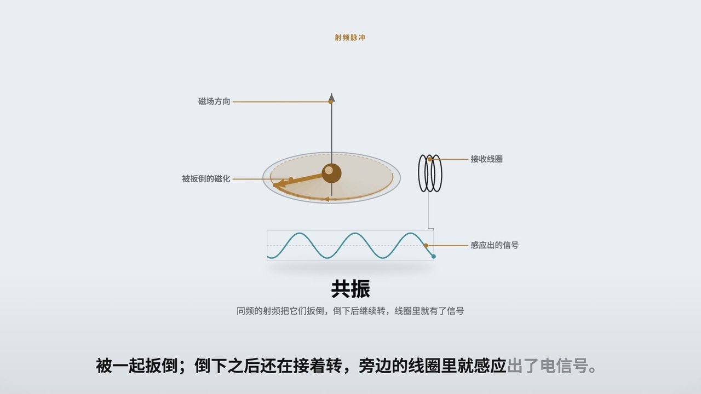
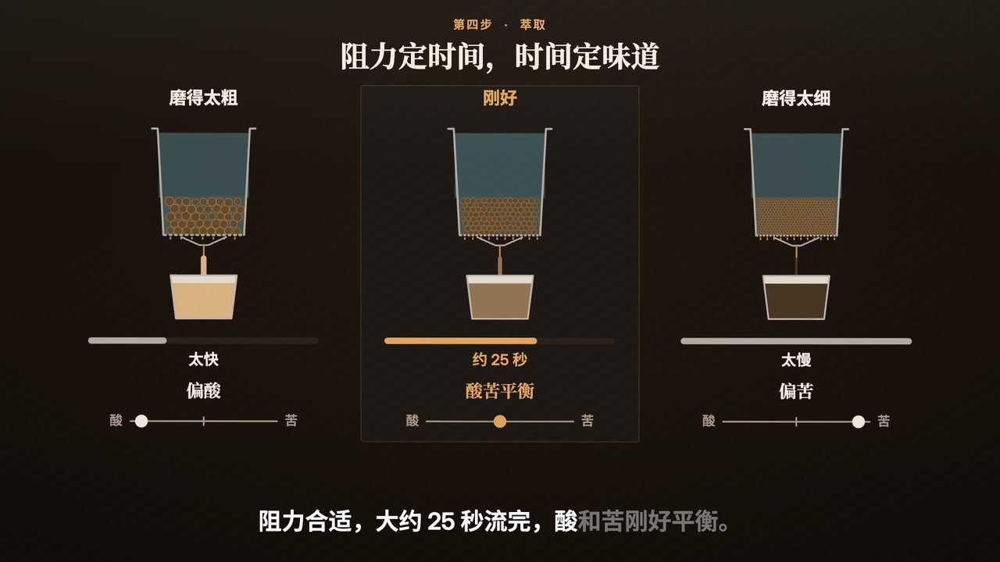
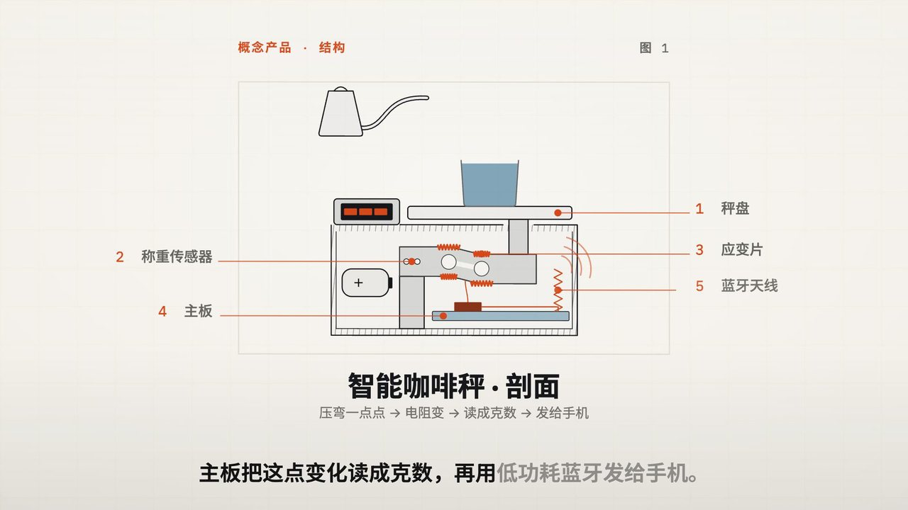
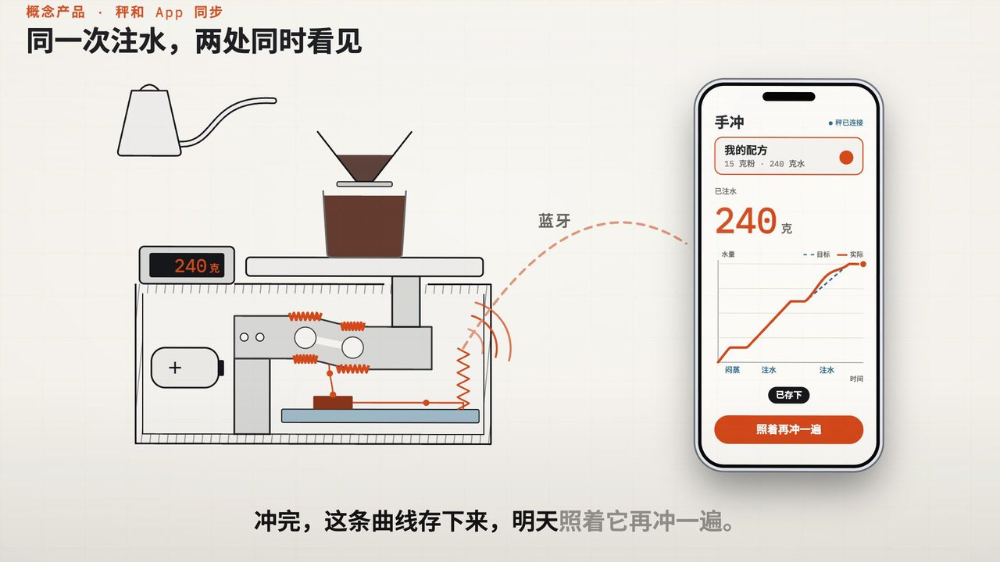
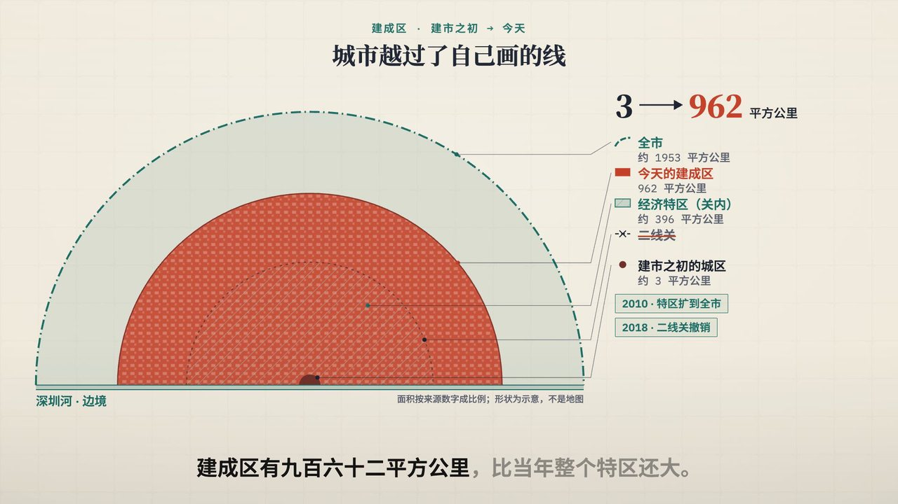

# topic-to-video：给一个主题，做成一条短视频

<p align="center">
  <a href="README.md"><strong>English</strong></a>
</p>

<p align="center">
  <a href="LICENSE"></a>
  
  
  
  
</p>

> **给它一个题目，比如"意式咖啡机是怎么萃取出一杯浓缩的"、"深圳是怎么从边境小镇长成超大城市的"，就能拿到一条一到两分钟、带配音和字幕的讲解短视频。画面上的每个事实，都能告诉你出处。**

在 Claude Code 或 Codex 里用聊天的方式调用。它不是"文字生成视频"的大模型，不靠 AI 去画每一帧。它更像一个小型讲解视频工作室：查资料（或者读你的幻灯片），写讲稿，配音，按每句话在讲什么来设计镜头；素材库里没有的画面元素就现场造出来；最后渲染成片，检查过后再交给你。

你能得到什么，以及需要知道的：

- 🔎 **有出处，不编造。** 解说里的每个日期和数字，都对应它抓到的网页原文里的一句话。几个来源说法不一致时，它会挑最站得住的那个，并在简报里写明取舍。找不到出处的数字，片子里就不说具体数，只做定性描述。
- 🎬 **逐个镜头设计。** 它从 194 种手工打磨的镜头设计里挑：剖面图、对比面板、路线图、时间线、手机演示、数据展台等。片子需要而库里没有的东西，比如一块咖啡粉饼的剖面、一台秤里的称重传感器、按真实比例画出的城市扩张，它会为这部片专门造出来，并确认遮住字幕也能看懂。
- 🗣️ **任何语言都能配音、配字幕。** 默认用免费的神经语音（edge-tts），字幕逐词同步，直接压在画面自己的背景上，中文同样支持。英文幻灯片也能配成中文解说，反过来也行。
- 🧪 **交给你之前先检查。** 文字有没有出画、字幕有没有压住内容、声画是否同步、镜头移动时文字会不会抖、有没有残留的占位文字。检查对象是渲染出来的真实画面，不是计划。
- 📐 **适配各种画幅。** 横屏 16:9、竖屏 9:16、方屏 1:1 等。每个镜头会针对画幅重新排版，而不是简单裁切。

需要提前说明的限制：它在本地运行，产出的是**文件**（MP4 加 SRT 字幕，会复制到你的桌面），没有云端版本，也没有分享链接。一条精致的五镜头短片需要实打实的工作时间：我们的测试片每条用了一到两个小时，大部分花在策划、制作和检查上；渲染本身只要几分钟。

<p align="center">
  <a href="#示例短片"><strong>示例短片</strong></a> ·
  <a href="#和其他工具有什么不同"><strong>有什么不同</strong></a> ·
  <a href="#两个分支怎么选"><strong>两个分支</strong></a> ·
  <a href="#工作流程"><strong>工作流程</strong></a> ·
  <a href="#快速开始"><strong>快速开始</strong></a> ·
  <a href="#常见问题"><strong>常见问题</strong></a>
</p>

## 示例短片

下面是四部短片的截图，每部都只给了一个题目，用中文制作。图里的画面元素都是片子自己画出来的，没有用素材库的现成图片。

<table>
  <tr>
    <td align="center" width="33%">
      <br/>
      <sub><strong>磁共振是怎么把人体内部变成图像的</strong><br/>质子被射频扳倒后继续转动，线圈里就有了信号</sub>
    </td>
    <td align="center" width="33%">
      <br/>
      <sub><strong>意式咖啡机怎么萃取一杯浓缩</strong><br/>松散的粉有缝隙，水会抄近路；压实后水均匀往下走</sub>
    </td>
    <td align="center" width="33%">
      <br/>
      <sub><strong>同一部片的高潮</strong><br/>阻力决定时间，时间决定味道</sub>
    </td>
  </tr>
  <tr>
    <td align="center" width="33%">
      <br/>
      <sub><strong>发布一台概念智能咖啡秤</strong><br/>剖面图：重量压弯传感器，主板读数，再用蓝牙发出去</sub>
    </td>
    <td align="center" width="33%">
      <br/>
      <sub><strong>同一部片的高潮</strong><br/>同一次注水，秤上和手机上同时看到</sub>
    </td>
    <td align="center" width="33%">
      <br/>
      <sub><strong>深圳：从边境小镇到超大城市</strong><br/>建成区按比例画出，3 → 962 平方公里，越过了当年特区的线</sub>
    </td>
  </tr>
</table>

## 和其他工具有什么不同

现在的"AI 视频"工具大多分两类。一类是生成式模型，动起来很好看，但事实容易出错，标签也很难放准位置。另一类是模板幻灯片，把你的文字铺在素材视频上。topic-to-video 走的是第三条路：**每一帧都是用代码画出来的**，文字、图表、数据都是真的，所以能做到准确，也能被检查。

- **画面在说同一件事。** 每个镜头都按它那句解说要表达的意思来挑、来造。遮住字幕，画面本身也应该能把意思讲清楚。自建的元素在渲染前就会按这个标准检验。
- **事实有凭据。** 简报里每个数字旁边都附着它的原文出处，你可以逐句核对一部片。
- **真实的地方，署名清楚。** 需要真实照片或地图时，它从维基共享资源找许可干净的图片，并在画面上标注作者和授权。
- **它会自己找毛病。** 检查都针对渲染出来的视频。比如有一项检查会逐帧找出镜头缓慢移动时文字一像素一像素跳动的问题，这种毛病看截图是发现不了的。
- **审美由你说了算。** 它会先给你看一版，你说哪里要改，它只重渲改动过的镜头。

## 两个分支怎么选

每部片由两个渲染分支之一来做，两者各有擅长的事。它会根据视频的用途给出建议，最终由你决定。

| | **电影分支**（Remotion） | **页面分支**（HTML） |
| --- | --- | --- |
| 镜头是什么 | 从 194 种手工设计里挑一个动画镜头（剖面、对比、路线、手机演示、数据展台等），加上片子为自己造的元素 | 每一拍一张精心设计的页面（流程、时间线、对比、表格、图表、代码、公式），按内容排版 |
| 动态 | 镜头推拉平移、景深和类 3D 的空间感，整部片统一规划转场 | 每个要点在解说念到它的那个词时出现，和配音同步 |
| 整片风格 | 一套设计方向（字体、配色、视觉母题）贯穿每个镜头 | 一套主题和页面样式；很适合杂志、印刷类的编辑风格 |
| 修改 | 只重渲改动的镜头和它衔接下一个镜头的那一段 | 只重渲改动的那一页；另有快速预览模式 |
| 需要 | Node.js（装一次 `npm install`），内存要求高一些 | 只需要 Chrome |
| **最适合** | **产品发布、宣传片、讲故事、讲某个机制怎么运作**：靠动态把道理讲清楚的片子 | **教学讲解、操作教程、研究汇报、给幻灯片配解说**：表格、图表、分步骤文字比较多的片子 |

路演和概览类两种都可以：重证据、重数据的适合页面分支，重故事、重品牌的适合电影分支。如果只是想让你自己的幻灯片原样配上解说，还有第三种方式：每页幻灯片全屏显示、带轻微运动，只需要 ffmpeg。

## 工作流程

1. **简报。** 先问你几个问题：视频用来做什么、什么语言、多长、竖屏还是横屏、用哪个分支。然后查资料或读你的幻灯片，把事实整理成带出处的简报。
2. **策划。** 写讲稿，一拍讲一个意思，并定下整部片的设计方向：字体、配色、镜头怎么切。
3. **制作。** 每一拍从库里挑镜头；库里没有合适的，就在这部片自己的工作区里造需要的元素或镜头。
4. **配音。** 逐拍配音，字幕和画面上元素的出现时机都对齐到说出的词。
5. **渲染和检查。** 渲染成片，跑画面、字幕、声画、运动等检查，然后把 MP4 和 SRT 复制到你的桌面。

## 快速开始

### 第一步：安装

需要 **Python 3.9+**、**ffmpeg** 和 **Google Chrome**（无界面运行，用来绘制画面）。用电影分支需要再装 **Node.js**；要输入 .pptx 文件需要 **LibreOffice**。

| 系统 | ffmpeg | LibreOffice（输入 .pptx 时需要） |
| --- | --- | --- |
| macOS | `brew install ffmpeg` | `brew install --cask libreoffice` |
| Linux | `sudo apt install ffmpeg` | `sudo apt install libreoffice` |

然后安装技能和它的 Python 依赖：

```bash
# Claude Code
git clone --depth 1 https://github.com/addsumtech/topic-to-video.git ~/.claude/skills/topic-to-video
# Codex
git clone --depth 1 https://github.com/addsumtech/topic-to-video.git ~/.agents/skills/topic-to-video

python3 -m pip install pillow pymupdf python-pptx edge-tts
```

要用电影分支，再执行一次：

```bash
cd ~/.claude/skills/topic-to-video/remotion && npm install
```

也可以用 [`npx skills`](https://github.com/vercel-labs/skills) 只装技能本身：`npx skills add addsumtech/topic-to-video`。上面那些工具仍然需要另外装好。

### 第二步：告诉它你要什么视频

开一个对话，直接描述：

```text
做一个讲解视频：深圳是怎么从边境小镇变成超大城市的，竖屏，中文配音。
```

```text
Make a 90-second video explaining how an espresso machine pulls a shot.
```

```text
把 slides/q3-review.pptx 做成带中文解说的视频。
```

它会简单问你几个问题，给你看计划，然后渲染，最后告诉你文件放在哪里。不用特意说"技能"两个字，只要说想做一个关于某个主题、或者从幻灯片做的视频就行。

## 适合的场景

- **讲解和教学**：某个东西怎么运作、某件事为什么会发生，一拍讲一个意思。
- **产品发布和演示**：概念产品、手机上的 App 操作流程、功能讲解。
- **地方和历史**：一座城市、一个年代、一条时间线，需要时配上署名的真实照片。
- **给现成的幻灯片配解说**：把一场分享或一份报告变成视频，可以用原语言，也可以换一种语言。
- **和 [slide-maker](https://github.com/addsumtech/slides_maker) 搭配**：在那里做幻灯片，在这里配成视频。

## 常见问题

- **缺了什么工具？** 在技能文件夹里运行 `python3 scripts/doctor.py`，它会列出每个工具的用途和对应的安装命令。
- **没有声音 / edge-tts 失败：** edge-tts 需要联网。在 macOS 上离线时，会自动改用系统自带的 `say` 语音。
- **没有出现电影分支的选项：** 在 `remotion/` 里运行 `npm install`（见第一步）。
- **找不到视频：** 它会复制到你的桌面（桌面不可写时放到"下载"文件夹），文件名就是片名。

## 许可证

[MIT](LICENSE)
