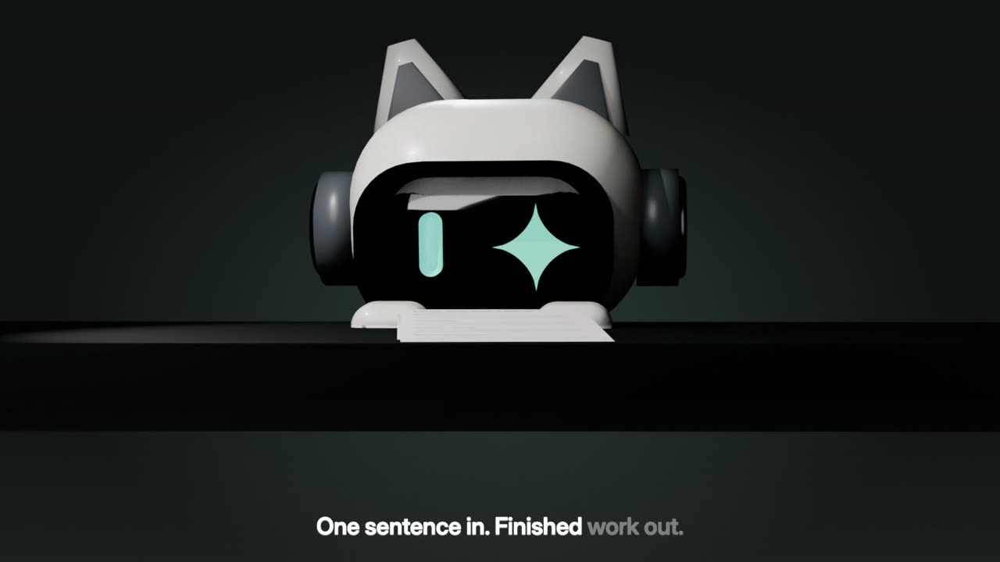
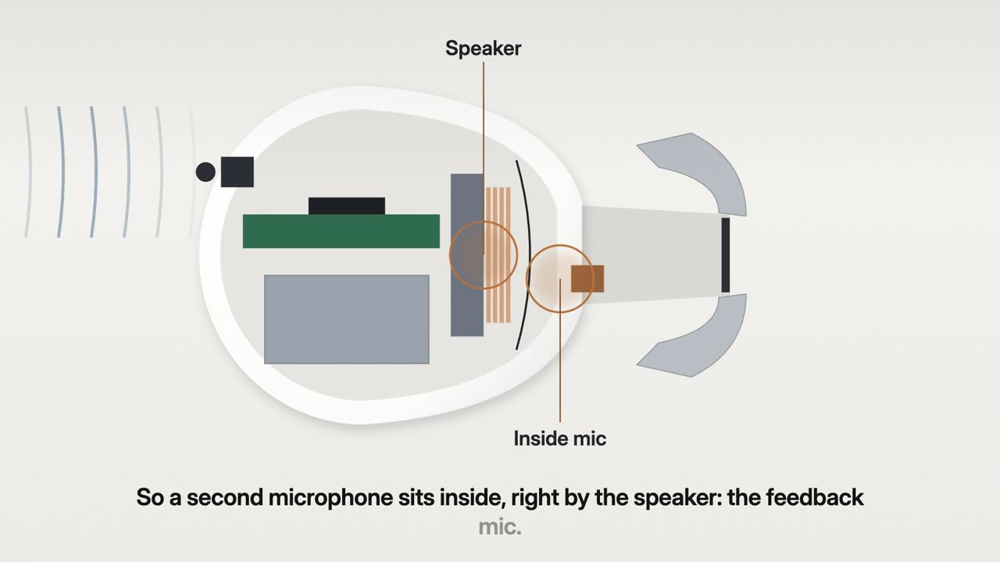
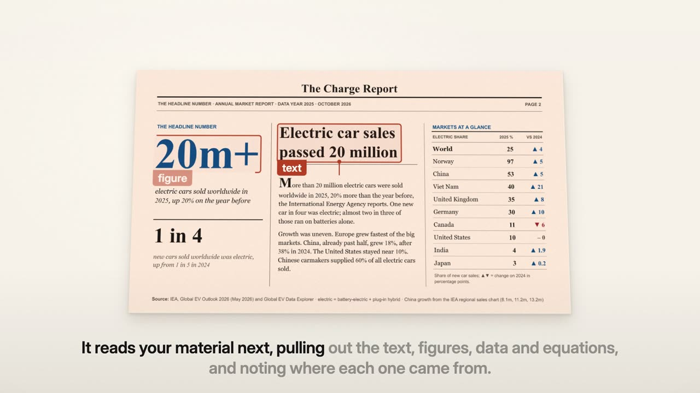
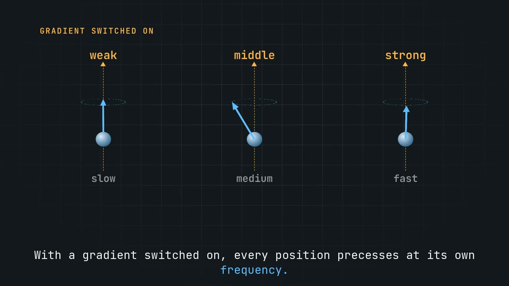
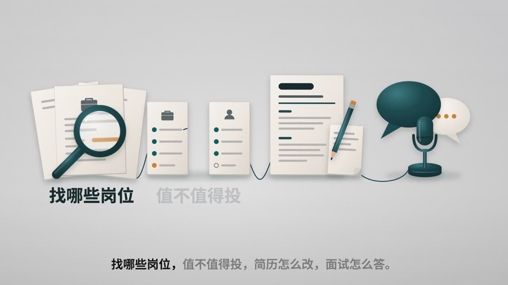

# topic-to-video

<p align="center">
  <a href="README.md"><strong>English</strong></a> ·
  <a href="https://video.addsum.top/cn/"><strong>看成片</strong></a>
</p>

<p align="center">
  <a href="LICENSE"></a>
  
  
  
  
  <a href="https://clawhub.ai/dong845/skills/topic-to-video"></a>
</p>

> **一句话进去，一条讲解短片出来。** 说一个主题，或者丢给它一份幻灯片：它查资料、写讲稿、配音、逐个设计镜头、渲染成带字幕的视频，并在交给你之前先检查一遍。

这是一个 Claude Code / Codex 技能。它不是靠大模型去"画"每一帧：**每一帧都是用代码画出来的**，文字、图表、数据都是真的。所以事实准确、标注不会错位，每一帧都能被检查。

## 用它做的片子

下面每一部都起于聊天里的一句话请求。点击可在 **[video.addsum.top](https://video.addsum.top/cn/)** 观看。

<table>
  <tr>
    <td width="33%"><a href="https://video.addsum.top/cn/#workbuddy-promo"></a><br/><sub><strong>产品宣传片</strong> · 英文 · 2:16<br/>照截图重建应用界面，六个镜头用 Blender 渲染</sub></td>
    <td width="33%"><a href="https://video.addsum.top/cn/#anc-headphones"></a><br/><sub><strong>主动降噪是怎么回事</strong> · 英文 · 2:43<br/>反相的波、两只麦克风、极短的时间窗口</sub></td>
    <td width="33%"><a href="https://video.addsum.top/cn/#slide-maker-promo"></a><br/><sub><strong>发布短片</strong> · 英文 · 2:48<br/>按配乐剪辑，画面里每页幻灯片都是真实产出</sub></td>
  </tr>
  <tr>
    <td width="33%"><a href="https://video.addsum.top/cn/#qr-code-explainer"></a><br/><sub><strong>二维码是怎么被读出来的</strong> · 中文 · 2:49<br/>片中每个二维码都真实生成，并用解码器验证过</sub></td>
    <td width="33%"><a href="https://video.addsum.top/cn/#mri-explainer"></a><br/><sub><strong>MRI 是怎么成像的</strong> · 英文 · 2:17<br/>画面里的 k 空间是实际计算出的傅里叶变换</sub></td>
    <td width="33%"><a href="https://video.addsum.top/cn/#job-hunt-promo"></a><br/><sub><strong>产品宣传片</strong> · 中文 · 2:32<br/>找岗位、判断匹配、改简历、练面试，一条故事线讲完</sub></td>
  </tr>
</table>

## 有什么不同

- 🔎 **有出处，不编造。** 解说里的每个日期和数字都对应它抓到的网页原文。找不到出处的数字，片子里只做定性描述。
- 🎬 **逐个镜头设计。** 从 225 种手工打磨的镜头设计里挑（剖面图、对比面板、路线、时间线、手机演示、数据展台），库里没有的就为这部片现场造。较重的 3D 镜头交给 Blender 渲染。
- 👁️ **画面本身在说话。** 每个镜头都按那句解说的意思来做：遮住字幕，画面也能把意思讲清楚。
- 🗣️ **任何语言，免费配音。** 默认用 edge-tts，字幕逐词同步，中文同样支持。英文幻灯片可以配中文解说，反过来也行。
- 🧪 **检查的是渲染出来的画面。** 文字出画、字幕压住内容、声画不同步、运镜时文字抖动、残留占位文字，都会被查出来。
- 📐 **任何画幅。** 16:9、9:16、1:1、4:5、4:3，镜头按画幅重新排版，而不是裁切。
- ✏️ **审美由你把关。** 先给你看一版早期渲染，你说改哪里，只重渲改动的镜头。

## 两种渲染方式

| | **电影分支**（Remotion） | **网页分支**（HTML） |
| --- | --- | --- |
| 一个镜头是 | 从 225 种设计里挑的动画镜头，加上为这部片造的物件 | 每一段一张为内容设计的页面：流程、表格、图表、代码、公式 |
| 运动方式 | 运镜、纵深、整部片统一规划的转场 | 每个要点在说到它的那个词时出现 |
| 最适合 | 产品发布、宣传片、故事、讲清一个机制 | 教学、操作指南、研究汇报、给幻灯片配解说 |
| 需要 | Node.js | 只要 Chrome |

只想给自己的幻灯片原样配上解说？还有第三种模式：每页幻灯片全屏展示、带轻微动效，只需要 ffmpeg。

## 快速开始

**1. 装好工具：** Python 3.9+、ffmpeg、Google Chrome。电影分支另需 Node.js，输入 .pptx 需要 LibreOffice，3D 镜头可选装 Blender。

```bash
# macOS（Linux：apt install ffmpeg libreoffice）
brew install ffmpeg && brew install --cask libreoffice
```

**2. 安装技能：**

```bash
# Claude Code
git clone --depth 1 https://github.com/addsumtech/topic-to-video.git ~/.claude/skills/topic-to-video
# Codex
git clone --depth 1 https://github.com/addsumtech/topic-to-video.git ~/.agents/skills/topic-to-video

python3 -m pip install pillow pymupdf python-pptx edge-tts
cd ~/.claude/skills/topic-to-video/remotion && npm install   # 电影分支，只需一次
```

<details>
<summary>其他安装方式：Claude Code 插件、npx skills、ClawHub</summary>

- **Claude Code 插件：** `/plugin marketplace add addsumtech/topic-to-video`，然后 `/plugin install topic-to-video@topic-to-video`。先删掉 `~/.claude/skills/` 里已有的副本，否则会出现两个同名技能。更新用 `/plugin marketplace update topic-to-video`。
- **npx skills：** `npx skills add addsumtech/topic-to-video`。
- **ClawHub / OpenClaw：** [clawhub.ai/dong845/skills/topic-to-video](https://clawhub.ai/dong845/skills/topic-to-video)。

不管用哪种方式安装，第 1 步的工具都需要；要用电影分支，在技能的 `remotion/` 文件夹里运行一次 `npm install`。
</details>

**3. 直接说你要什么视频**，不用提"技能"两个字：

```text
做一个讲解视频：深圳是怎么从边境小镇变成超大城市的，竖屏，中文配音。
Make a 90-second video explaining how an espresso machine pulls a shot.
把 slides/q3-review.pptx 做成带中文配音的讲解视频。
```

它会先问几个问题，给你看计划和一版早期渲染，最后把 MP4 和 SRT 复制到你的桌面。

## 需要知道的

- **本地文件，不是云服务。** 产出是 MP4 加 SRT 字幕，没有账号，也没有分享链接。
- **好片子需要时间。** 我们的测试片每条用了一到两个小时，大部分花在策划、制作和检查上；渲染本身只要几分钟。
- **缺了什么工具？** 运行 `python3 scripts/doctor.py`，它会列出每个工具和对应的安装命令。
- **没有声音？** edge-tts 需要联网。macOS 离线时会改用系统自带的 `say` 语音。
- **和 [slide-maker](https://github.com/addsumtech/slides_maker) 搭配：** 在那边做幻灯片，在这里配成视频。

## 许可证

[MIT](LICENSE)
