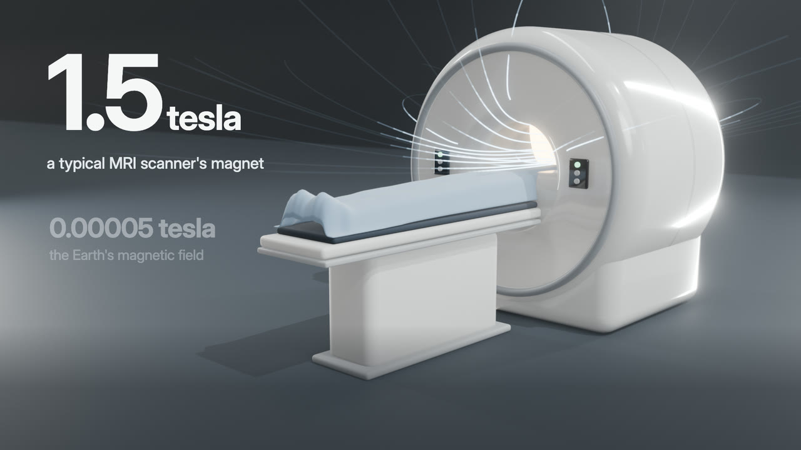
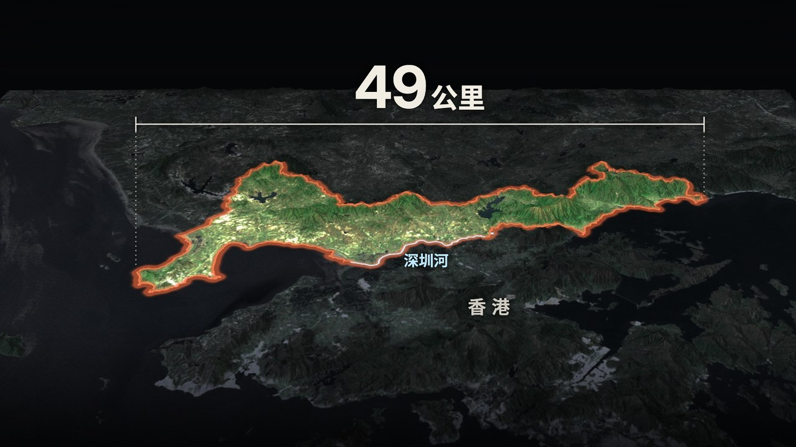
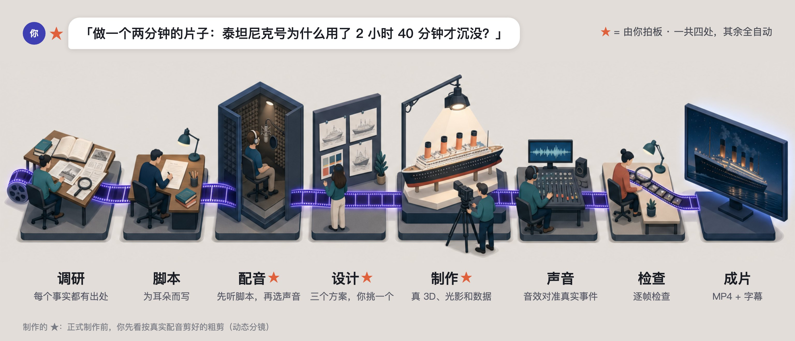

# topic-to-video

<p align="center">
  <a href="README.md"><strong>English</strong></a> ·
  <a href="https://video.addsum.top/cn/"><strong>看成片</strong></a> ·
  <a href="#快速开始"><strong>快速开始</strong></a>
</p>

<p align="center">
  <a href="https://github.com/addsumtech/topic-to-video/releases"></a>
  <a href="LICENSE"></a>
  
  
  
  
</p>

> **你当导演，它就是整个摄制组。** 说一句话，拿回一部查过资料、配好解说、设计过、检查过的成片：在你自己的电脑上做，默认免费。

这是一个 Claude Code / Codex 技能，把你的智能体变成一间小型影视工作室：调研、编剧、配音、设计、3D 美术、声音和质检一应俱全。没有一帧是视频大模型"画"出来的：**每一帧都用代码搭建、再渲染出来**，文字、3D、数据和应用界面都是真的。所以事实准确、物理过程是算出来的，每一帧都能被检查。

## 用它做的片子

下面每一部都起于聊天里的一句话。点击即可观看，全部十七部在 **[video.addsum.top](https://video.addsum.top/cn/)**。

<table>
  <tr>
    <td width="33%"><a href="https://video.addsum.top/cn/#titanic-sinking"></a><br/><sub><strong>泰坦尼克号为什么用了 2 小时 40 分钟才沉没</strong> · 英文 · 1:49<br/>船按 1911 年图纸在 Blender 里建模；进水过程依据 1912 年的调查报告</sub></td>
    <td width="33%"><a href="https://video.addsum.top/cn/#diamond-sparkle-3d"></a><br/><sub><strong>钻石为什么会闪闪发光</strong> · 中文 · 1:44<br/>每颗钻石都用 Blender 渲染，火彩是真实的色散</sub></td>
    <td width="33%"><a href="https://video.addsum.top/cn/#mri-explainer"></a><br/><sub><strong>MRI 是怎么拍出身体内部的</strong> · 英文 · 2:07<br/>一张真实脑切片由它自己的和弦重建；扫描仪用 Blender 渲染</sub></td>
  </tr>
  <tr>
    <td width="33%"><a href="https://video.addsum.top/cn/#shenzhen-border-town"></a><br/><sub><strong>深圳是怎么变成超大城市的</strong> · 中文 · 2:10<br/>用 1979 到 2025 年真实的 Landsat 卫星影像讲述</sub></td>
    <td width="33%"><a href="https://video.addsum.top/cn/#falling-cat"></a><br/><sub><strong>猫为什么总能四脚着地</strong> · 中文 · 2:03<br/>两节圆柱模型，画成孔版印刷的样子</sub></td>
    <td width="33%"><a href="https://video.addsum.top/cn/#qr-torn-corner"></a><br/><sub><strong>二维码撕掉一角为什么还能扫</strong> · 中文 · 1:45<br/>一张真实的二维码，每一种撕法都用真实解码器验证</sub></td>
  </tr>
  <tr>
    <td width="33%"><a href="https://video.addsum.top/cn/#grok-bot-promo-38s"></a><br/><sub><strong>Grok Bot 38 秒宣传片</strong> · 英文 · 0:38<br/>只有文字和配乐，全程在应用的官方截图里</sub></td>
    <td width="33%"><a href="https://video.addsum.top/cn/#camera-lens"></a><br/><sub><strong>镜头怎样拍出清晰的照片</strong> · 英文 · 2:01<br/>从一个光点讲到一锥光线重新会聚</sub></td>
    <td width="33%"><a href="https://video.addsum.top/cn/#numbers-chart-tutorial"></a><br/><sub><strong>在 Numbers 里做一张图表</strong> · 英文 · 1:16<br/>软件操作教程：每一次点击都录自真实软件</sub></td>
  </tr>
</table>

## 它怎么做片

<p align="center"></p>

你只需要拍板四次：做什么、用哪个声音（先听过讲稿）、选哪个设计、粗剪行不行。其余它自己跑完，成片 MP4 和字幕直接放到你的桌面。

## 有什么不同

| | 视频生成大模型 | **topic-to-video** |
| --- | --- | --- |
| **画面** | 模型猜出来的像素，文字和数字经常是乱码 | 用代码搭建再渲染：准确的文字、真 3D、真数据、真实的应用界面 |
| **事实** | 听起来对就行 | 每个数字都追溯到原文出处；找不到出处的只做定性描述 |
| **物理** | 看起来像 | 算出来的：钻石的火彩来自真实色散，泰坦尼克号的进水依据 1912 年的调查报告 |
| **时长** | 几秒的片段 | 1–3 分钟带解说的完整影片，字幕逐词同步，任何语言 |
| **改一处** | 重新抽卡碰运气 | 用大白话说要改哪里，只重做受影响的镜头 |
| **花费** | 按片段计费 | 默认免费：本地渲染，免费配音 |

而且每部片都有一个只有这个题材才有的**招牌创意**：会唱出自己和弦的脑切片、在片子自己的画面上被解码的二维码、海水依次漫过泰坦尼克号的每一道隔墙。

## 里面有什么

| 角色 | 做什么 |
| --- | --- |
| **调研** | 读你给的材料或上网查，每个日期和数字都钉在它抓到的原文上 |
| **编剧和配音** | 为耳朵写稿，先让你试听，再配音（默认免费的 edge-tts，可选 MiniMax 或 OpenAI），逐词计时，并把配音转写回来，查出漏读或读错的句子 |
| **设计** | 三个方向、一个招牌创意和完成度很高的关键帧；再按真实配音把整部片做成粗剪 |
| **制作** | 物件用 Blender 和带光影的 3D 舞台，文字用排版动效，真实的照片、地图和卫星影像，应用和终端录自真实程序 |
| **声音** | 音效只配在真实发生的动作上；只有发布片才配乐，并压在人声之下 |
| **质检** | 对渲染出来的成片跑最多 15 项自动检查（闪帧、运镜一顿一顿、色带、文字被截断或重叠、物体穿模），再把每个镜头放到原尺寸逐一查看 |

## 两条路径

| | **导演式**（默认） | **经典模式** |
| --- | --- | --- |
| 做出来的是 | 作为整体设计的一部片：一种风格、一个招牌创意，一段一段地搭出来 | 幻灯片原样配解说、每段一张设计好的 HTML 页面，或用 227 种手工打磨的镜头设计拼出的影片（Remotion） |
| 最适合 | 讲解片、发布片和产品片，任何需要"做出来"质感的片子 | 给现成幻灯片配解说、教学页面、用镜头库快速出片 |
| 需要 | Chrome；真 3D 需要 Blender | 只要 ffmpeg（幻灯片原样）；Chrome（页面）；Node.js（Remotion） |

说一个主题或产品，走的就是导演式；说"把我的幻灯片原样配音"或点名要镜头库，走的就是经典模式。

## 快速开始

**1. 装好工具：** Python 3.9+、ffmpeg、Google Chrome。真 3D 镜头可选装 Blender，输入 .pptx 需要 LibreOffice，经典模式的 Remotion 渲染需要 Node.js。

```bash
# macOS（Linux：apt install ffmpeg libreoffice）
brew install ffmpeg && brew install --cask libreoffice
```

**2. 安装技能：**

```bash
# Claude Code
git clone --depth 1 https://github.com/addsumtech/topic-to-video.git ~/.claude/skills/topic-to-video
# Codex
git clone --depth 1 https://github.com/addsumtech/topic-to-video.git ~/.agents/skills/topic-to-video

python3 -m pip install pillow pymupdf python-pptx edge-tts pyte faster-whisper pypinyin
cd ~/.claude/skills/topic-to-video/remotion && npm install   # 经典模式的 Remotion 渲染，只需一次
```

<details>
<summary>其他安装方式：Claude Code 插件、npx skills</summary>

- **Claude Code 插件：** `/plugin marketplace add addsumtech/topic-to-video`，然后 `/plugin install topic-to-video@topic-to-video`。先删掉 `~/.claude/skills/` 里已有的副本，否则会出现两个同名技能。更新用 `/plugin marketplace update topic-to-video`。
- **npx skills：** `npx skills add addsumtech/topic-to-video`。

不管用哪种方式安装，第 1 步的工具都需要；要用 Remotion 渲染，在技能的 `remotion/` 文件夹里运行一次 `npm install`。
</details>

**3. 直接说你要什么视频**，不用提"技能"两个字：

```text
做一个讲解视频：深圳是怎么从边境小镇变成超大城市的，竖屏，中文配音。
用 ./press-kit 里的截图，给我们的应用做一支发布短片。
Make a 2-minute video explaining how an espresso machine pulls a shot.
把 slides/q3-review.pptx 做成带中文配音的讲解视频。
```

它会先问几个问题，让你试听讲稿，给你看设计和动态分镜，最后把 MP4 和 SRT 复制到你的桌面。

## 需要知道的

- **本地文件，不是云服务。** 产出是 MP4 加 SRT 字幕，没有账号，也没有分享链接。
- **好片子需要时间。** 一部精心设计的片子要花几个小时的智能体时间，大部分花在设计、制作和检查上；渲染本身只要几分钟。
- **缺了什么工具？** 运行 `python3 scripts/doctor.py`，它会列出每个工具和对应的安装命令。
- **没有声音？** edge-tts 需要联网。macOS 离线时会改用系统自带的 `say` 语音。
- **和 [slide-maker](https://github.com/addsumtech/slides_maker) 搭配：** 在那边做幻灯片，在这里配成视频。

## 许可证

[MIT](LICENSE)。`assets/html/moments.js` 中部分动效时值改编自
[video-shotcraft](https://github.com/Vincentwei1021/video-shotcraft)（Apache-2.0），详见 [NOTICE](NOTICE)。
