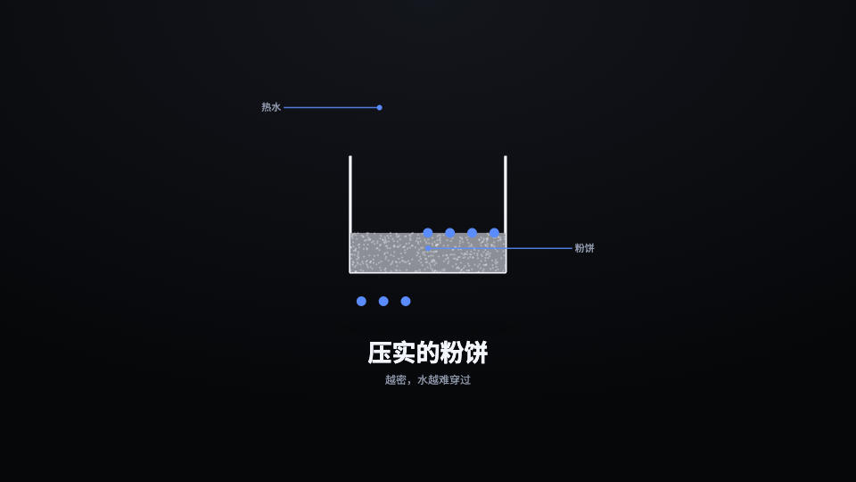
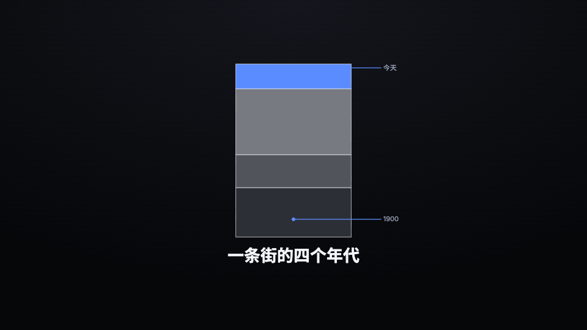
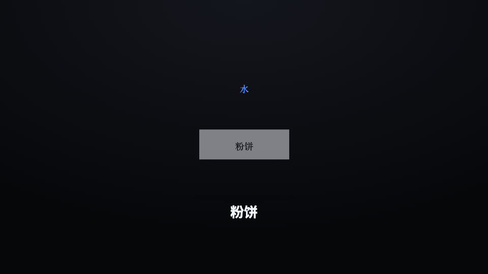

# Object authoring — building a thing a film needs

A film builds an OBJECT when its beat needs a thing no register draws: a coffee puck in section, a sensor, a street's
strata, an interface that does not exist yet. The object lives in the film's workshop
(`python3 scripts/workshop.py <out_dir> new-object <Name> --means "<what the viewer must see>"`), goes into a register
that has a slot for one — `ObjectStage`, `ObjectCompare`, `ObjectPath`, `ObjectTurntable`, `TechnicalPlate` (`art`),
`HudReticle` (`object`), a device's `screen` — and is named on the film's `meta.build_list`. What to draw it WITH is
`references/building-blocks.md`.

## The five rules

1. **It ENCODES its beat.** Hide the caption: the object must still carry THIS beat's idea — the build-list entry's
   `means`, tested by its `accept`. On topic by colour or subject is not enough (see SwirlOfCoffee below).
2. **It is a designed diagram, not an imitation of a photograph.** When a beat needs the thing as it LOOKS, the
   documentary tier composites a real, credited image (`scripts/imagefetch.py`, `PhotoPlate`, `MuseumLabel`); an
   object shows how a thing WORKS or what it MEANS — a section, a flow, a state, a count.
3. **Every word comes from props, and no figure is invented.** The film writes its words in its own language; an
   object that writes its own prints them in every film (`workshop.py check` and `shot_proof.py` both refuse it). A
   word that genuinely belongs to the form — a unit symbol, an axis letter — is declared `// @fixed-text: <why>`. A
   quantity the object shows comes from a prop the film sourced; texture is declared `// @decor: <why>`.
4. **It sizes to its box.** It is drawn at `w × h`, whatever those are; `META.aspect` says the shape it wants and the
   slot letterboxes it. No fixed pixels, nothing outside the box unless it is meant to overhang.
5. **It is a pure function of `t`.** `t` runs 0 → 1 over the part of the beat its host gives it and then holds; at
   any frame the object is fully determined — no `Math.random`, no `Date`. What its host does with `t` is on the
   host's card (ObjectPath hands it the object's progress along the route; TechnicalPlate its drawing phase).
   **Moving type glides:** a transform or position that moves words goes through `glide()` from `@runtime/glide`
   over the span it moves in, or Skia steps the type a pixel at a time — `text_safe_qa.py <out_dir> --glide` refuses it.
6. **A natural cycle keeps running on `idle`.** Once a stage's reveal is over it HOLDS `t` at 1 until the cut, and
   a frame frozen for a third of its beat is a slideshow. So the slot also hands `idle`: seconds held since the
   host's reveal ended, easing up from rest and back down before the cut (0 under reduced motion, on a beat whose
   storyboard sets `"object_idle": false`, and for an object whose `META` says `idle: false`). An object whose thing
   genuinely cycles — water flowing, a precession turning, a wheel spinning — keeps that cycle going from it
   (`phi = phiSettled + 2π·rate·idle`), with the settled `t = 1` picture as its starting state, and keeps words
   off whatever moves. An object with no cycle ignores it; never invent one. A stage's callout stays where the
   SETTLED part was, so a callout that names a part the cycle carries away (the tip of a precessing arrow) ends
   up pointing at empty space: label what holds still, or set `"object_idle": false` on that beat.

`META` carries `aspect`, `provenance` (the idiom world its look comes from — the film's `idiom_world` is judged on
it), for an object that draws its own 3D from `yaw`, `turns: true` (objects/DemoForm is the reference), and for a
static diagram the idle clock must never move, `idle: false`.

## Three good objects

### A mechanism in cutaway — `PuckInSection`

Drops enter at the top and fight down through a packed bed; the more `packed`, the thinner and denser the bed and
the fewer drops get through. Caption hidden, the beat's claim — resistance is the point — is on the frame. It draws
no words: the stage's labels name the bed and the water. Source: `object-examples/PuckInSection.tsx`.

### Layered strata — `StrataOverTime`

A column grows layer by layer, each as thick as the film's numbers say, the newest on top in the accent. The eras'
names are the stage's labels; the object draws only what the numbers say. Source: `object-examples/StrataOverTime.tsx`.

### An interface being operated — `ComposeScreen`

A screen that does not exist yet, drawn for a device (`{"screen": {"object": …}}`): the draft types itself in and
the send button lights when it is done. The recipient, the draft and the button are props. Source:
`object-examples/ComposeScreen.tsx`.

## Three bad objects — and which of them the gates catch

### An imitation of a photograph — `ChromeMachine`

Gradients and a highlight dressing up an espresso machine. It is clip-art, it shows no mechanism, and it competes
with the real machine a documentary image would show. **It passes every gate.**

### Words written into the object — `LabeledPuck`

The bed and the water are named in Chinese in the code, so every film prints Chinese there and no prop can change it.
**`workshop.py check` refuses it** (and `shot_proof.py` names the words on the frame).

### Decoration that carries nothing — `SwirlOfCoffee`

A turning spiral in coffee colours: on topic by colour and by nothing else. Hide the caption — it says nothing about
extraction. **It passes every gate.**

Two of the three bad objects pass every machine check. A gate measures type, words and geometry; it cannot measure
meaning. That is why the shot-critic judges every built thing on its rendered frames (`agents/shot-critic.md` S15),
and why the build list states `means` and `accept` before anything is drawn.

## The loop

1. Write the build-list entry first: `means` (what the viewer must see) and `accept` (how it is judged).
2. `workshop.py <out_dir> new-object <Name> --means "…"`, draw it, `workshop.py <out_dir> still <Name>` — LOOK at the
   settled frame, caption hidden. A screen on a device is previewed with `--host DeviceDemo` (or `DeviceHero`):
   the still takes the beat that shows it and prepares its step script the way the film plays it; `--frame N`
   looks at a tap's moment. `still` writes one `_stills/<Name>.png` per name, so copy it aside before a second host.
3. `workshop.py check` until it is clean; then `validate.py`, render, and the film gates.
4. The critic judges it against `means` and `accept` (S15). At delivery the user decides whether it is promoted
   (`scripts/promote.py`).
